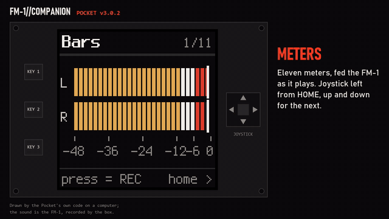
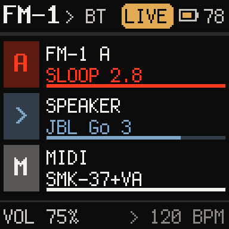
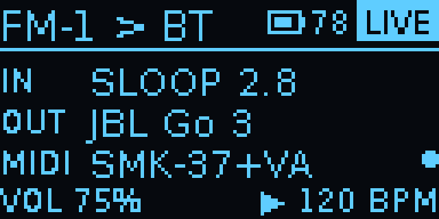
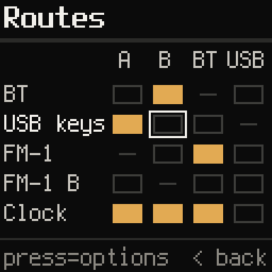
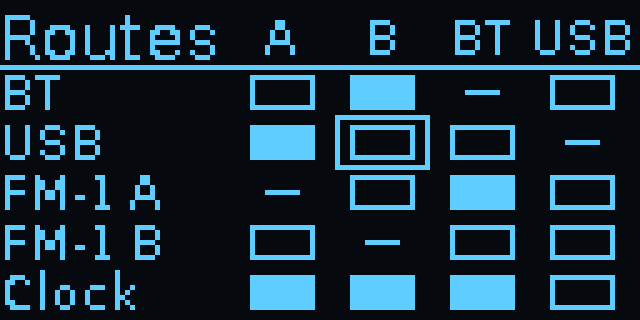
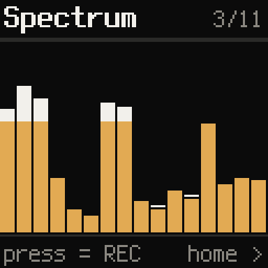
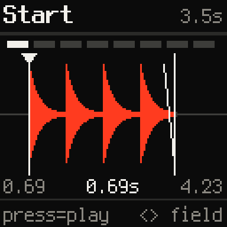
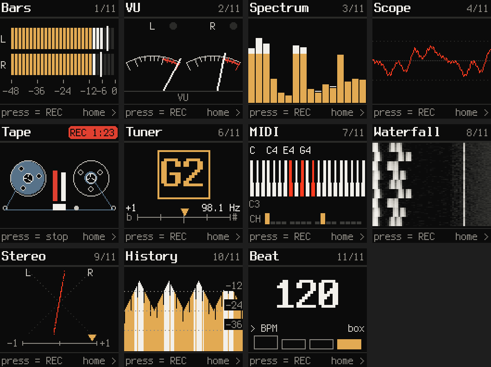
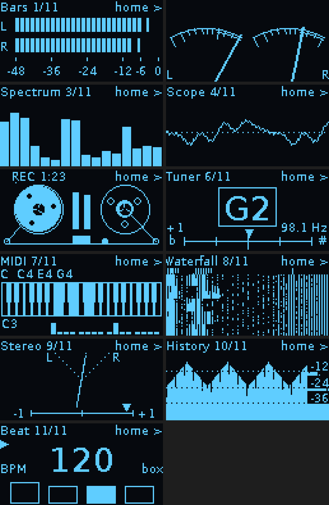
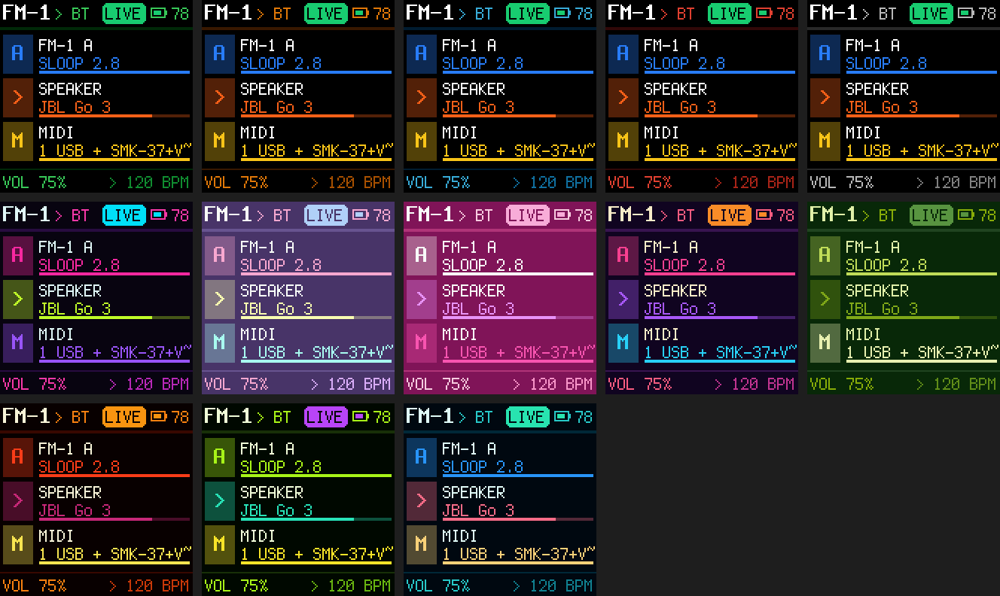

# FM-1 Companion

**A pocket sidekick for the M-VAVE FM-1 synth.** Bluetooth audio and MIDI, a mixer, a recorder that keeps the
MIDI too, a sample editor, meters, a MIDI matrix and a library for the FM-1's backups, on a Raspberry Pi Zero with
a small screen HAT, with no computer needed once it's set up. By [XOXO Audio Labs](https://xoxoaudiolabs.com).

**[xoxoaudiolabs.com](https://xoxoaudiolabs.com)** · [The Pocket](https://xoxoaudiolabs.com/products/fm1-companion-pocket/)
· [Web app launcher](https://xoxoaudiolabs.com/app/) · [What's new](docs/CHANGELOG.md)

[](https://cdn.jsdelivr.net/gh/xoxoaudiolabs/FM-1-Companion@main/docs/video/fm1-companion-pocket-v3.0.2.mp4)

**[▶ Pocket demo](https://cdn.jsdelivr.net/gh/xoxoaudiolabs/FM-1-Companion@main/docs/video/fm1-companion-pocket-v3.0.2.mp4)**
(1:46, with sound): HOME, the eleven meters, Settings, the library, DX7 patches, the MIDI routes, the sample
editor, the mixer and the themes, on the 1.44" LCD in the XOXO theme. Drawn by the box's own screen code on a
computer, pressing the keys a user would (each one lit); it isn't filmed. Its sound is real: the FM-1, recorded by
the box, and the meters are fed it. Made with `tools/render_video.py`.


It started as a way to add the Bluetooth that custom FM-1 firmware such as [SLOOP](https://github.com/isod89/sloop-fm1)
leaves switched off, and grew from there. Plug it into the FM-1 by USB and run it from its own screen or from
your phone.

## The Studio is XOXO Studio now

The FM-1 Companion used to come in two builds: the Pocket and the Studio (a Pi 3 with a 3.5" touchscreen). The
Studio grew past the FM-1 and carries on as **[XOXO Studio](https://github.com/xoxoaudiolabs/XOXO-Studio)**, a
portable studio for any MIDI and USB gear. The FM-1 comes back to it as a plug-in:
**[fm1-companion](https://github.com/xoxoaudiolabs/XOXO-Studio-Plugins/tree/main/fm1-companion)** in
[XOXO Studio Plugins](https://github.com/xoxoaudiolabs/XOXO-Studio-Plugins), which uses this repository's library.

This repository is the Pocket. A Pocket still links to a Studio (Settings › Studio link). The Studio's releases
from here (tags `studio-v1.0` to `studio-v1.6`) stay as they were, and a Studio running one isn't offered anything
newer from here. Their release notes are at the end of [What's new](docs/CHANGELOG.md).

## Compatibility

The Pocket needs a **Pi Zero with wireless** (Zero W, Zero WH, Zero 2 W) for its Bluetooth, and a **Waveshare
Zero screen HAT** with the joystick and three keys. Which boards, screens and OS versions are tested, which should
work, and which won't: [the setup guide's Compatibility](fm1-bt-bridge/README.md#compatibility). What Bluetooth
does and doesn't do: [Bluetooth](fm1-bt-bridge/README.md#bluetooth-what-the-pocket-can-and-cant-do).

Built one on different hardware, or had trouble? [Tell us](https://github.com/xoxoaudiolabs/FM-1-Companion/issues/new?template=hardware-report.yml): run `fm1-report` on the box and paste what
it prints. Adding a part or a screen driver: [HARDWARE.md](HARDWARE.md).

## What it does

- **Wireless audio and MIDI.** The FM-1 plays on Bluetooth headphones or a speaker, and the box shows up as a
  Bluetooth MIDI device, **"FM-1 Companion"**, for a phone, iPad, computer or keyboard to play the FM-1. It can
  also connect to keyboards that wait to be connected to (a microKEY Air, a WIDI; not tried with real ones yet).
- **More keyboards, a second FM-1.** Up to four USB MIDI keyboards and a second FM-1 through a hub, found by
  themselves. **FM-1 A** and **FM-1 B** keep their names by hub port.
- **A mixer.** Each FM-1 and each USB audio device at its own level, 0–200%.
- **A recorder and a sample editor.** Record to WAV, with a `.mid` of what was played beside each take, and
  **Record parts** for each source as its own file. Turn a take into a sample: trim, fade, normalize, reverse,
  tune it to its note, ready to load into the FM-1.
- **Playing tools.** MIDI clock (follow, or lead with tap tempo and Start/Stop), metronome, arpeggiator and
  chord memory.
- **A MIDI matrix.** Route Bluetooth, USB keyboards, the FM-1s and the box to each other: transpose, re-channel,
  reshape velocity, pick a key range or split a keyboard, and filter, with four presets.
- **Eleven meters.** LED bars, VU needles, spectrum, scope, a tape deck, a tuner, a keyboard view, a waterfall, a
  goniometer, a level history and a beat counter.
- **Looks after the FM-1 (SLOOP 2.3+).** Back up and restore everything on it, back up and load songs, load
  projects and samples, and install firmware: [SLOOP](https://github.com/isod89/sloop-fm1) or isod89's experimental
  [Clipper](https://github.com/isod89/clipper-fm1). Backups are SLOOP's own files.
- **Backs up Felucca too** ([Hügelton's](https://github.com/hugelton/Felucca), 1.x): back up and restore everything
  on it, and load a project from a backup, in Felucca's own backup files (its web editor reads them). Not tried on an
  FM-1 running Felucca yet: built from its published protocol. Songs and samples stay SLOOP's for now.
- **And JIANT FM** ([juanjiant-bit's](https://github.com/juanjiant-bit/JIANT), 0.3 and later): the same, with every
  song it keeps (its song index and each song's sections). Not tried on an FM-1 running JIANT yet.
- **And X0X** ([charlesvestal's](https://github.com/charlesvestal/fm1-x0x)): back up its project (sounds, the 32
  patterns, the song, knob motion, settings) as X0X's own `.x0b`, and restore one: X0X asks on its screen first. Not
  its break loops. Not tried on an FM-1 running X0X yet.
- **And Jangada** ([zednaked's](https://github.com/zednaked/jangada)): back up and restore everything on it (projects,
  presets, both FM6 banks, samples), in Jangada's own backup files; load a project; DX7 patches go to it. Not tried on
  an FM-1 running Jangada yet.
- **And sloopDX** ([zvenson's](https://github.com/zvenson/dxsloop)): SLOOP's backups with all 8 of its DX7 banks (it is
  stepped through them, then set back to the one in use; stop the song first), and a DX7 bank file loads into its bank
  in use (backed up first). Not tried on an FM-1 running sloopDX yet.
- **And Clipper** (isod89's synth): back up and restore everything on it, and load a project, as on SLOOP (not its
  songs or samples). Not tried on an FM-1 running Clipper yet.
- **And Melodee** ([keremimo's](https://github.com/keremimo/melodee)): back up and restore everything on it (its presets
  and every project), in Felucca's backup files as its own editor makes them; load a project; DX7 patches go to it. Not
  tried on an FM-1 running Melodee yet.
- **And Baud Girl's FM-1+VA** (closed source): back up and restore its 128 presets (each read back after it's
  written), from what the community has worked out of her web tools, so an update of hers may change it. Not its
  patterns. Not tried on an FM-1 running FM-1+VA yet.
- **A web app on your phone** at `http://<the box's hostname>.local`: live status, the mixer, the MIDI matrix, a
  sample editor, your recordings and the library. [xoxoaudiolabs.com/app](https://xoxoaudiolabs.com/app/) opens
  your box's page.
- **DX7 patches** for FM-1 firmwares that take them: a library of `.syx` banks, sent whole or a voice at a time
  (not tried on such a firmware yet). On M-VAVE's stock firmware it can also save the sound the FM-1 plays now as a
  voice (the way [czietz/fm1-read-voice](https://github.com/czietz/fm1-read-voice) reads it; not tried here). A whole
  bank replaces 32 of stock's presets, and its factory reset doesn't bring the factory ones back.
- **A Studio link.** Linked to a Studio on the same network (Wi-Fi, or one Ethernet cable from the HUB HAT): MIDI
  both ways, the Studio's clock, and the Pocket's sound played on the Studio.
- **Coming:** 5-pin DIN MIDI in, out and thru, on an expansion card of its own (in its own repository).

```
                               ┌── Bluetooth audio ──▶ headphones / speaker
                               ├◀── Bluetooth MIDI ──▶ keyboard / iPad / phone / Mac
FM-1 ◀── USB ──▶ Pocket        ┤
 (audio, MIDI, backups,        ├◀── USB ────────────▶ USB MIDI keyboards, USB audio, a second FM-1
  samples, firmware)           ├◀── Wi-Fi/Ethernet ─▶ web app on your phone; a Studio (the Studio link)
                               └── its own screen: meters, mixer, recorder, sample editor
```

## Getting started

Everything is in [`fm1-bt-bridge/`](fm1-bt-bridge/). Its [README](fm1-bt-bridge/README.md) covers what to buy,
flashing the SD card, installing, the controls and troubleshooting. In short:

```
scp -r fm1-bt-bridge YOUR_USER@fm1bridge.local:~
ssh YOUR_USER@fm1bridge.local
bash fm1-bt-bridge/install.sh
sudo reboot
```

Use the hostname you gave the box when you flashed its card (`fm1bridge` above). The installer is for a Pi Zero
W or Zero 2 W; on a Pi 3 or 4 it stops and points to XOXO Studio.
It's ready about a minute after power-on.

## Screens

Drawn by the Companion's own code on a computer (`tools/render_screens.py`).

| | On the LCD | On the OLED |
|---|---|---|
| **Home** |  |  |
| **MIDI routes** |  |  |
| **Meters** |  |  |
| **Sample editor** |  |  |

<details><summary>More screens: every meter, the themes</summary>

**The Pocket's eleven meters on the LCD** (joystick left from HOME; up/down changes meter, press records)



**The Pocket's eleven meters on the OLED**



**The Pocket's HOME in each theme** (Settings › Theme on the LCD)


</details>

## What's new

The latest releases; every release in full: **[docs/CHANGELOG.md](docs/CHANGELOG.md)**.

- **Pocket v3.0: ten FM-1 firmwares in the library, Settings in seven pages.** Backups and restores for the
  FM-1 whatever it runs: SLOOP, Clipper, sloopDX, Felucca, JIANT FM, Melodee, Jangada and X0X, Baud Girl's
  FM-1+VA's presets, and the sound a stock FM-1 plays now, each in its own backup files (only SLOOP tried on an
  FM-1 yet). Settings opens with Mixer, Playing, MIDI, Bluetooth, Studio link, Library and Box; Library's first page
  is named after what the FM-1 runs. Keep backups, a shorter Projects list, DX7 patches to the FM-1 that takes them.
  ([More](docs/CHANGELOG.md#pocket-v30-ten-fm-1-firmwares-in-the-library-settings-in-seven-pages))
- **Pocket v2.13: splits and key ranges, the XOXO themes, a steadier Studio link.** A MIDI route can pass only
  a range of keys or split a keyboard onto a second channel, scale velocity by a percentage, and arpeggiate at
  1/16T or 1/32 over up to four octaves, with hold. The colour screen's themes are now XOXO (the new default) and
  the eight Studio themes, after FM-1 A's own colours. The Studio link comes back by itself when the Pocket's
  sound stream restarts.
  ([More](docs/CHANGELOG.md#pocket-v213-splits-and-key-ranges-the-xoxo-themes-a-steadier-studio-link))
- **Pocket v2.12: a Studio link, one-click updates, a new web app, SLOOP songs.** The Pocket links to a Studio
  over Wi-Fi or an Ethernet cable: MIDI both ways, the Studio's clock, and the Pocket's sound played on the Studio.
  The web app updates the box to the newest release and keeps your settings and library, and it's redrawn. SLOOP songs backed up and loaded back; a DX7 bank loader (not
  tried on a firmware that takes DX7 patches yet).
  ([More](docs/CHANGELOG.md#pocket-v212-a-studio-link-one-click-updates-a-new-web-app-sloop-songs))
- **Pocket v2.11: more boards and screens, a tidier Settings.** Any Pi Zero with wireless, the 1.3" LCD HAT (not
  tried yet) and the OLED over I2C; a screen picker, `fm1-screen` and `fm1-report`; an installer that checks the
  Pi first; Settings opening with Mixer, MIDI routes, Sample editor, Sloop, FM-1 and Bluetooth.
  ([More](docs/CHANGELOG.md#pocket-v211-more-boards-and-screens-a-tidier-settings))
- **Pocket v2.10: a colour screen.** The Waveshare 1.44" LCD HAT as well as the OLED, every screen and meter
  redrawn in colour with the Studio's look, and Settings › Theme. The OLED's screens are unchanged.
  ([More](docs/CHANGELOG.md#pocket-v210-a-colour-screen))

## Tested on the real hardware

What the Pocket has been seen doing for real. Everything else in [What it does](#what-it-does) is built and has
automated tests, but hasn't been tried on the real box yet: it's in the second list until it has.

A Pi Zero W on Raspberry Pi OS Lite (Trixie) with the Waveshare OLED HAT, later the Waveshare 1.44" LCD HAT on the
Waveshare Ethernet/USB HUB HAT, and a PiSugar 3; FM-1s on SLOOP 2.7 and 2.8; a JBL Go 3; an M-VAVE SMK-37 (over Bluetooth MIDI, and over USB through an ASMedia ASM1074 hub, running Baud
Girl next to two FM-1s).

**Tested**
- Bluetooth audio to a JBL Go 3.
- Bluetooth MIDI: the SMK-37 connecting to the box and playing the FM-1 (up to v2.8.3).
- USB MIDI keyboards through a hub (the SMK-37 on the ASM1074).
- Two FM-1s at once on the hub.
- The library on a real FM-1: a backup, a restore (read back byte for byte), a project load, a sample load, and
  the update from SLOOP 2.7.1 to 2.8 with projects, presets and samples kept.
- Recording to WAV, and the warning when a take clipped (its threshold measured on real FM-1 takes).
- Record parts: each source as its own WAV next to the mix.
- The sample editor, and loading what it saves with Sloop > Load sample.
- The metronome, the arpeggiator and chord memory.
- The PiSugar 3: the battery gauge and the low-battery warning.
- The box as MIDI clock master: exact tempo on average, single ticks about 3 ms early or late (measured while
  playing to a speaker).
- Start-up: about 54 s from power-on to the Companion (measured on Trixie).
- The Bars, VU, Spectrum and Scope meters: about a quarter of the CPU while shown, no audio dropouts.
- The 1.44" LCD HAT (v2.10): every screen, the meters and Settings › Theme, with an FM-1 plugged in. A meter frame
  takes 15–31 ms to draw on the Zero W.
- Reading FM-1 A's theme at start-up for the LCD (a theme made in SLOOP's editor).
- The HUB HAT under it: the Zero W finds its USB hub and Ethernet adapter, with no under-voltage.
- The screen picker on the 1.44" LCD (v2.11): KEY1 on its prompt, KEY1 again to keep it, remembered after a
  restart; `fm1-screen` and `fm1-report` on the real Pocket.
- The Studio link (v2.12) over Wi-Fi and over an Ethernet cable from the HUB HAT, with the FM-1 Companion Studio
  (XOXO Studio's start): MIDI both ways, the Studio's clock, and the Pocket's FM-1 heard on the Studio, coming back
  after the Pocket's sound stream restarted.
- The update (v2.12): an install from a release file as the updater does it, settings and all 57 library files
  kept as they were; going back to the code from before; the web app asking, the box's hold-press, and an update
  turned down when there's nothing newer, with nothing restarted.
- The MIDI matrix's new route options (v2.13) on the 1.44" LCD Pocket: key ranges, a split, velocity % and arp
  hold saved and read back, a wrong value refused, a split saved from the web app's route editor.
- The themes (v2.13) on the 1.44" LCD: Settings › Theme with XOXO and the eight, each shown as the cursor moves.
- The Studio link (v2.13) over the cable: the Pocket's sound stream stopped on purpose, a new one started and
  heard on the Studio again within 5 s, with nothing done by hand.
- SLOOP songs (v2.12) on an FM-1 running SLOOP 2.8: a song backed up, then loaded back from the box and again from
  `library.py`, read back the same, a backup made first each time. The DX7 loader refusing that SLOOP FM-1 (SLOOP
  doesn't take DX7 patches).

**Not tested on the real Pocket yet**
- From v2.9: connecting to Bluetooth MIDI keyboards (BT keys) and several Bluetooth MIDI devices at once. v2.9 runs
  on the Pocket, but no such keyboard has been tried.
- v2.10 on the OLED HAT: its screens are compared as pictures on a computer only.
- Following FM-1 A's colours on the LCD as they change: the theme is read, but the screen hasn't been watched
  following a change.
- The HUB HAT's extra USB ports.
- The Studio link with Wi-Fi off (the cable only), the Pocket's Ethernet coming up by itself after a restart, and
  the Pocket handing its Bluetooth speaker over to the Studio while linked.
- A whole online update to a newer release: v2.12 is the first release with the updater, so the first real one is
  the next release. A box on v2.11 or older needs one update over SSH to get it.
- A Pi Zero 2 W, 64-bit Raspberry Pi OS, and Bookworm (for this release).
- The 1.3" LCD HAT (ST7789), and the OLED HAT switched to I2C.
- Sending DX7 patches to a firmware that takes them (M-VAVE's own, FM-1+VA): automated tests only.
- The new web app's Studio link, theme, auto backup and speaker controls (tried only in a browser with sample
  data).
- The safe shutdown at 5% battery.
- Installing Clipper: downloaded and accepted by SLOOP's installer, never flashed to an FM-1.
- Playing notes through v2.13's key ranges, splits, velocity % and the new arp rates and hold: saved and shown
  on the box, but not yet played on a keyboard. The Studio link inviting itself again after the Studio restarts
  (v2.13): automated tests only.
- The rest, with automated tests only: the MIDI matrix's route options and presets, the other seven meters,
  auto backup, SD card import and the Wi-Fi switch.

## Known limits

- **Bluetooth audio delay:** about 150–250 ms with SBC (the codec is whichever the headphones pick; others
  differ). Fine for listening and practising; you'll notice it when
  playing tightly in time.
- **Recordings clip if the FM-1 sends USB at full level** with several tracks playing (inside the FM-1, before the
  box hears it). The box warns you; set the FM-1's USB audio to master with the knob around half.
- **USB devices charge from the battery:** on the PiSugar alone, devices with batteries (the FM-1s) charge from
  it and flatten it in minutes. Keep it plugged in, or use a powered USB hub.
- **Chords over Bluetooth MIDI arrive slightly rolled** (10–50 ms) with keyboards that send each note in its own
  packet.
- **On the Pi Zero:**
  - **On battery, the FM-1 runs and charges from it too:** the Pi Zero's USB port can't switch its power off, so
    the battery lasts far less with the FM-1 plugged in. A small hardware switch is planned (its parts are on order).
  - **Plugging the FM-1 straight in while the Pi runs can reboot it** (the port has no current limit). Connect
    the FM-1 first, or use a USB hub: replugging the FM-1 on the hub is fine.
  - **USB runs at 12 Mbit/s** so a hub works on the Pi Zero: fine for MIDI and the FM-1's audio, slow for a fast
    USB stick.
  - **Start-up takes about a minute** on the Zero's single core; Wi-Fi comes up about 40 s later (the optional
    `config/fm1-native-wifi` step in the [box README](fm1-bt-bridge/README.md) saves about a minute more).
- **Moving the card to another Pi:** Bluetooth pairings belong to the Pi's own Bluetooth chip, so speakers,
  keyboards and phones need pairing again (seen when the Pocket moved to another Zero W).
- **With two FM-1s (or a keyboard's synth), plain recordings need the speaker connected** to hear the whole mix;
  with Record parts on, the mix is made from the parts and needs none. Firmware installs wait until only one FM-1
  is plugged in.

<details><summary>What's in the repository</summary>

| Path | What it is |
|---|---|
| `fm1-bt-bridge/bridge.py` | The app: screens, headphone pairing, audio routing and the mixer (PipeWire), keys |
| `fm1-bt-bridge/blemidi.py` | Bluetooth LE MIDI (BlueZ), the FM-1's USB MIDI and USB keyboards, the clock, the MIDI matrix with its arp and chord memory, the metronome, in a process of its own |
| `fm1-bt-bridge/libui.py` | The library's settings (a page for the FM-1's firmware), recordings and their screens |
| `fm1-bt-bridge/meters.py` | The eleven meters, recording and playback, pitch detection |
| `fm1-bt-bridge/midiui.py` | The MIDI matrix screens |
| `fm1-bt-bridge/sampleui.py` | The sample editor's screen on the Pocket |
| `fm1-bt-bridge/lcd.py` | The Pocket's colour LCD HATs (1.44" ST7735S, 1.3" ST7789) |
| `fm1-bt-bridge/pocketui.py` | The Pocket's screens on the LCD, in colour, and Settings › Theme |
| `fm1-bt-bridge/pocketmeters.py` | The eleven meters on the LCD |
| `fm1-bt-bridge/dx7.py` | DX7 banks and voices for firmwares that take them: read, named, sent |
| `fm1-bt-bridge/netaudio.py` | The Pocket's Studio link: its sound to the Studio over the network (PipeWire RTP) |
| `fm1-bt-bridge/update.py` | The web app's one-click update |
| `fm1-bt-bridge/config/fm1-update` | Installs the newest release for the update (root helper, run through sudo) |
| `fm1-bt-bridge/config/50-fm1-ethernet-link.conf` | An Ethernet cable straight to a Studio gets an address with no router |
| `fm1-bt-bridge/battery.py` | The PiSugar battery's charge, read over I2C |
| `fm1-bt-bridge/device.py` | Which Pi the Pocket is on and what it can do |
| `fm1-bt-bridge/x0x.py` | X0X's own backups (.x0b): read, checked and described |
| `fm1-bt-bridge/mvave.py` | M-VAVE's updater protocol: which firmware family, X0X backups, a stock FM-1's sound |
| `fm1-bt-bridge/baudgirl.py` | Baud Girl's FM-1+VA presets: backup and restore |
| `fm1-bt-bridge/netmidi.py` | Network MIDI (RTP-MIDI): the Studio link's MIDI |
| `fm1-bt-bridge/sloopstyle.py` | SLOOP's palettes, track colours, font and themes, for the colour screens |
| `fm1-bt-bridge/sampler.py` | The sample editor's sums, shared by the box and the web page |
| `fm1-bt-bridge/metronome.py` | The metronome's click stream |
| `fm1-bt-bridge/library.py` | The library's jobs (backup, restore, projects, samples, firmware); also a command-line tool |
| `fm1-bt-bridge/sloop.py` | SLOOP's editor protocol over USB MIDI; which FM-1 is A and which is B |
| `fm1-bt-bridge/samplefast.py` | SLOOP's sample converter made faster, byte for byte the same |
| `fm1-bt-bridge/web.py` | The web app at http://fm1bridge.local |
| `fm1-bt-bridge/weblink.py` | How the box and the web app talk |
| `fm1-bt-bridge/vendor/` | SLOOP's firmware installer and sample converter (GPL-3.0) and the Terminus font (SIL OFL), unchanged and credited in `VENDORED.md` |
| `fm1-bt-bridge/install.sh` | Installs packages, configuration and the boot services |
| `fm1-bt-bridge/config/` | PipeWire, WirePlumber, polkit, systemd, swap, Wi-Fi, Ethernet and SD-card configuration |
| `tests/` | A pretend FM-1 speaking SLOOP's protocol, and tests for everything else (`python tests/test_library.py` etc.; needs mido, Pillow and numpy) |
| `tools/render_screens.py` | Draws the screens as PNG files for this README, without a Pi |
| `tools/render_video.py` | Makes the demo video from the box's own screens and a recording of the FM-1, without a Pi |
| `tools/midi_timing.py` | Analyses the Bluetooth MIDI timing log |
| `docs/` | The images and the video on this page |
</details>

## License

GPL-3.0, like SLOOP. See [LICENSE](LICENSE).

The colour screens' palettes and track colours are SLOOP's (isod89/sloop-fm1, GPL-3.0), and their font is
Terminus by Dimitar Toshkov Zhekov (SIL Open Font License 1.1), as SLOOP ships it.

**Copied into this repository** (each with its licence beside it):

| What | From | Licence |
|---|---|---|
| `fm1-bt-bridge/vendor/sloop/` (`fm1_install.py`, `sampleio.py`) | [SLOOP](https://github.com/isod89/sloop-fm1), unchanged ([VENDORED.md](fm1-bt-bridge/vendor/sloop/VENDORED.md)) | GPL-3.0-only |
| `fm1-bt-bridge/vendor/fonts/` (Terminus) | Dimitar Toshkov Zhekov, as SLOOP ships it ([VENDORED.md](fm1-bt-bridge/vendor/fonts/VENDORED.md)) | SIL Open Font License 1.1 |

**Built on** Raspberry Pi OS and its packages (PipeWire, BlueZ, Python, Pillow, NumPy, mido and others),
each under its own licence: [the full list](docs/CREDITS.md).
