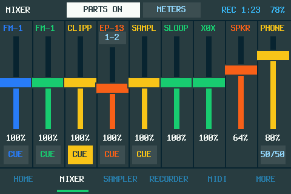
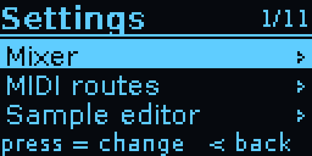
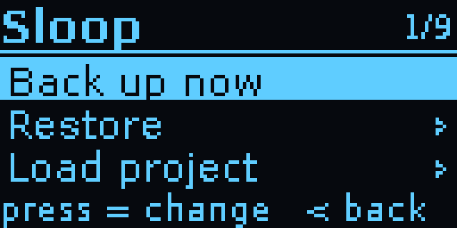
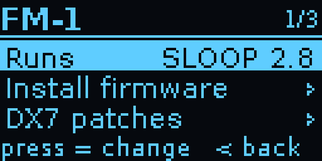

# FM-1 Companion

**A studio sidekick for the M-VAVE FM-1 pocket synth.** Bluetooth audio and MIDI, a mixer, a recorder, a sample
editor, eleven meters (ten on the Studio) and a MIDI matrix, with no computer needed once it's set up. By
[XOXO Audio Labs](https://xoxoaudiolabs.com).

**[xoxoaudiolabs.com](https://xoxoaudiolabs.com)** · [The Pocket](https://xoxoaudiolabs.com/products/fm1-companion-pocket/)
· [The Studio](https://xoxoaudiolabs.com/products/fm1-companion-studio/) ·
[Try the web app](https://xoxoaudiolabs.com/app/) (sample data, in your browser)

| The Studio | The Pocket |
|---|---|
| [](https://cdn.jsdelivr.net/gh/xoxoaudiolabs/FM-1-Companion@main/docs/video/fm1-companion-studio-v1.3.mp4) | [](https://cdn.jsdelivr.net/gh/xoxoaudiolabs/FM-1-Companion@main/docs/video/fm1-companion-demo-v2.6.1.mp4) |
| **[▶ Watch the Studio tour](https://cdn.jsdelivr.net/gh/xoxoaudiolabs/FM-1-Companion@main/docs/video/fm1-companion-studio-v1.3.mp4)** (1:12, with sound): HOME, the mixer with cue, ten meters, the sampler, SLOOP's sequencer and FX, the recorder, MIDI and MORE, with each tap shown (drawn by the Studio's own code on a computer, not filmed). Two FM-1s and an SMK-37 played by Claude over MIDI, recorded by the Studio. | **[▶ Watch the Pocket demo](https://cdn.jsdelivr.net/gh/xoxoaudiolabs/FM-1-Companion@main/docs/video/fm1-companion-demo-v2.6.1.mp4)** (1:46, with sound): the box's own screens (drawn by its code on a computer, not filmed), all eleven meters, the settings, the MIDI matrix and the sample editor, with an overlay of each button press. The music was played on the FM-1 and recorded by the box. |


It started as a way to add the Bluetooth that custom FM-1 firmware such as [SLOOP](https://github.com/isod89/sloop-fm1)
leaves switched off, and grew from there. Plug it into the FM-1 by USB and run it from its own screen or from
your phone.

## Two builds, one codebase

| | **The Pocket** | **The Studio** |
|---|---|---|
| Computer | Raspberry Pi Zero W | Raspberry Pi 3 B+ |
| Screen and controls | 1.3" OLED, joystick and three keys (Waveshare HAT) | 3.5" 480×320 touchscreen, in SLOOP's style and colours |
| Battery | PiSugar 3 | PiSugar 3 Plus (5000 mAh) |
| Adds | Fits in a pocket | An MPC-style sampler with SLOOP's sequencer and punch-in FX, a recorder, a headphone jack with DJ-style cue, every USB MIDI device routed on its own, a DAW control surface (Kraken; Ableton Live untested), four USB ports, Ethernet, HDMI out |
| Software | v2.8.3 | Studio v1.3 (running on the real hardware since October 2026) |
| More | [Product page](https://xoxoaudiolabs.com/products/fm1-companion-pocket/) | [Product page](https://xoxoaudiolabs.com/products/fm1-companion-studio/) |

The installer works out which build it's on, and each build only shows what its hardware can do.

## What it does

What's been tried on the real boxes, and what hasn't yet: [Tested on the real hardware](#tested-on-the-real-hardware).

- **Wireless audio and MIDI.** The FM-1 plays on Bluetooth headphones or a speaker, and the box shows up as a
  Bluetooth MIDI device, **"FM-1 Companion"**, so a phone, iPad, computer, or a keyboard that connects to
  Bluetooth MIDI devices itself, can play the FM-1.
- **More keyboards, a second FM-1.** Through a USB hub (or the Studio's four ports): up to four USB MIDI
  keyboards and a second FM-1, found by themselves. **FM-1 A** and **FM-1 B** keep their names by the hub
  port they're on.
- **A mixer.** Every sound source gets its own level, 0–200%: each FM-1 and each USB audio device (a
  keyboard's own synth, a mic, an audio interface), added up before Bluetooth.
- **A recorder and a sample editor.** Record to WAV, play takes back, and turn a take into a sample: trim,
  fade, normalize, reverse and tune it to its note, ready to load into the FM-1. **Record parts** also keeps
  each source as its own file next to the mix.
- **Playing tools.** MIDI clock (follow, or lead with tap tempo and Start/Stop), metronome, arpeggiator and
  chord memory.
- **A MIDI matrix.** Route Bluetooth, USB keyboards, the FM-1s and the box to each other: transpose,
  re-channel, reshape velocity and filter, with four presets.
- **Eleven meters.** LED bars, VU needles, spectrum, scope, a reel-to-reel tape deck, a tuner, a keyboard view,
  a waterfall, a stereo goniometer, a level history and a beat counter (the Studio shows ten, without the tuner).
- **Looks after the FM-1 (SLOOP 2.3+).** Back up and restore everything on it (by hand or automatically), load
  projects and samples, and install firmware: [SLOOP](https://github.com/isod89/sloop-fm1), or isod89's
  experimental [Clipper](https://github.com/isod89/clipper-fm1). Backups are SLOOP's own files, so they open in
  SLOOP's web editor too.
- **A web app on your phone** at `http://fm1bridge.local` (Wi-Fi, or Ethernet on the Studio): live status, the
  mixer, the MIDI matrix, a sample editor with a waveform you drag, your recordings and the library.
  Installable on your home screen. [Try it with sample data](https://xoxoaudiolabs.com/app/).
- **A sampler (the Studio).** 16 pads in kits, an MPC's or laid out as SLOOP's drum track. Sample any source
  onto a pad, trim it in the touch sample editor, play it from the screen or any MIDI keyboard. SLOOP's drum
  sequencer for the pads (up to 64 steps, swing, ratchets, nudge, live recording), note repeat, and sixteen
  of SLOOP's punch-in FX (the original set: loops, stutter, reverse, tape stop, filters, crush, gate, echo, wobble).
- **A recorder and headphones (the Studio).** The RECORDER tab with the reel-to-reel deck; the Pi's 3.5 mm jack
  as a second output with no Bluetooth delay, a cue button on every source (DJ-style, before its fader) and a
  cue/main blend.
- **Plays with your DAW (the Studio).** A network MIDI device (RTP-MIDI) whose DAW tab is a Mackie Control
  surface for [Kraken](https://github.com/isod89/sodwave-site): 8 touch faders with track names, meters, pan,
  solo, mute and the transport. Ableton Live's Mackie Control should work too, but it hasn't been tried yet.
- **Coming:** 5-pin DIN / TRS MIDI in, out and thru (the Pocket's v3, the Studio's first expansion card).

```
                               ┌── Bluetooth audio ──▶ headphones / speaker
                               ├◀── Bluetooth MIDI ──▶ keyboard / iPad / phone / Mac
FM-1 ◀── USB ──▶ Pocket/Studio ┤
 (audio, MIDI, backups,        ├◀── USB ────────────▶ USB MIDI keyboards, USB audio, a second FM-1
  samples, firmware)           ├◀── Wi-Fi/Ethernet ─▶ web app on your phone; a DAW (the Studio)
                               └── its own screen: meters, mixer, recorder, sample editor
```

## Getting started

Everything is in [`fm1-bt-bridge/`](fm1-bt-bridge/). Its [README](fm1-bt-bridge/README.md) covers what to buy,
flashing the SD card, installing, the controls and troubleshooting. In short:

```
scp -r fm1-bt-bridge YOUR_USER@fm1bridge.local:~
ssh YOUR_USER@fm1bridge.local
bash fm1-bt-bridge/install.sh
sudo reboot
```

It's ready about a minute after power-on.

## Screens

The same jobs on both boxes. Every image is drawn by the Companion's own code (`tools/render_screens.py`).

| | The Pocket | The Studio |
|---|---|---|
| **Home:** the FM-1s, the speaker, MIDI, the volume, the clock; LIVE and the battery |  |  |
| **Mixer:** a level for each FM-1 and USB device, up to 200%, and Record parts |  |  |
| **MIDI routes:** sources down the side, destinations across; FM-1 B and the Studio's NET when connected |  |  |
| **Meters:** eleven on the Pocket (ten on the Studio, no tuner), from LED bars to a tape deck and a waterfall |  |  |
| **Settings:** Playing, Audio, MIDI, Recordings, Sloop, FM-1; on the Studio, values with - / + by touch |  |  |
| **Sample editor:** a take trimmed, faded and tuned into a sample for SLOOP; on the Studio, drag the markers |  |  |
| **Recorder:** REC and the time; on the Studio, its own tab with the reel-to-reel deck |  |  |
| **Sampler** (the Studio): 16 pads, SLOOP's sequencer, punch-in FX | |  |
| **DAW** (the Studio): a Mackie Control surface for Kraken (Ableton Live: untested) | |  |

<details><summary>More of the Pocket's screens</summary>

| | | |
|---|---|---|
|  |  |  |
| Recording: REC and the time | Volume, in 2% steps | Settings: its sections |
|  |  |  |
| Sloop: backups, projects, samples | FM-1: firmware | A route: transpose, velocity, channels |
|  |  |  |
| A recording: play, edit, parts, delete | The note it found by listening | A take playing |
|  |  |  |
| Speakers found by a scan | A SLOOP update running | The screensaver |
</details>

<details><summary>Every meter on each box (eleven on the Pocket, ten on the Studio)</summary>

**The Pocket** (joystick left from home; up/down changes meter, press records)


**The Studio** (MIXER > METERS; tap the meter for the next)


</details>

## What's new

### Studio v1.3

The first release made on the real Studio, with a sampler, a recorder and headphones.

| The sampler: 16 pads in a kit | SLOOP's sequencer for the pads |
|---|---|
|  |  |
| **Sixteen of SLOOP's punch-in FX** | **The recorder** |
|  |  |

- **SAMPLER.** 16 pads in kits (MPC notes 36-51, or SLOOP's drum layout so SLOOP's own sequencer plays them),
  sampled from any source, trimmed in the touch **EDITOR** (OPEN lists your samples and takes, TO PAD puts the
  edit on a pad). **SEQ**: SLOOP's drum sequencer, up to 64 steps a pattern with levels, ratchets, nudge, swing
  and live REC. **RPT**: note repeat. **FX**: sixteen of SLOOP's punch-in FX on the pads, held or latched.
- **RECORDER**, its own tab: the reel-to-reel deck, REC, Record parts and your takes.
- **Headphones.** The Pi's 3.5 mm jack: speaker, jack or both; a PHONES fader; a CUE button on each source
  (heard on the jack before its fader) and a cue/main blend, as on a DJ mixer.
- **Every USB MIDI device on its own.** The MIDI routes give each one a row and a column by name (an SMK-37,
  a K.O. Sidekick), remembered when it's unplugged. All four USB ports carry audio and MIDI at once; a second
  device of the same model is numbered.
- **An FM-1 keeps the clock.** With several USB audio devices, an FM-1 is the one the others are re-timed to:
  a keyboard's synth taking it over made the headphone jack drop out and everything crackle.
- **New screens:** a boot screen from power-on to HOME, a touch setup on first start, a cleaner tab bar
  (HOME, MIXER, SAMPLER, RECORDER, MIDI, MORE; METERS under MIXER, DAW under MIDI), MORE as tiles, smoother
  meters, an HDMI mirror of the screen.
- **Made for the real hardware:** the screen driver Raspberry Pi OS ships now (piscreen, at 24 MHz), touch
  calibration, the PiSugar 3 Plus, an SMK-37 running Clipper told apart from an FM-1.

| The boot screen | The MIDI routes, a device each |
|---|---|
|  |  |

**Connecting a DAW:** on the computer, open network MIDI (Mac: Audio MIDI Setup › MIDI Studio › Network;
Windows: the free rtpMIDI driver) and connect a session to each of the Studio's two ports. In Kraken, set the
port connected to "FM-1 Companion MCU" to Mackie; in Live, choose MackieControl as a control surface on that port.

### Pocket v2.8

| Two FM-1s in the MIDI routes | The mixer |
|---|---|
|  |  |

- **Two FM-1s at once,** named A and B by their hub port, each with its own row and column in the MIDI routes.
- **An audio mixer:** each sound source at its own level, 0–200%, added up before Bluetooth.
- **Record parts (v2.8.1):** each source as its own file next to the mix, from one recording, so they line up to
  the sample.
- **Faster:** one connection to the audio system kept open, about half the CPU it took before.

<details><summary>Release history</summary>

**Studio**
- **v1.2:** every screen drawn for touch (settings, lists, route details, jobs), hold to confirm anything that
  writes to the FM-1, the sample editor by touch, Wi-Fi and Shut down in MORE.
- **v1.1:** network MIDI (RTP-MIDI) with a music port and a Mackie Control port; the DAW tab for Kraken (Ableton
  Live untested); every USB audio device on its own named mixer channel, with an input pair for multichannel
  interfaces.
- **v1.0:** the Studio's first release: tabs along the bottom, SLOOP's font, palettes and track colours,
  following FM-1 A's colour theme, the meters redrawn in colour (ten: no tuner), the card slot's pin map and
  card ID plan (the box doesn't read the ID yet) ([docs/studio-expansion-cards.md](docs/studio-expansion-cards.md)).

**Pocket**
- **v2.8.3:** the shared fixes of Studio v1.3 (an SMK-37 running Clipper next to an FM-1 is a keyboard, not a
  third FM-1; FM-1 A's MIDI found by its sound card).
- **v2.8.2:** a long USB device name in Settings › Audio no longer runs into its level on the OLED.
- **v2.8:** two FM-1s, the mixer, a much lighter audio connection. **v2.8.1:** Record parts.
- **v2.7:** USB MIDI keyboards through a hub, found by themselves; the FM-1 can be replugged on the hub without a
  reboot (v2.7.1).
- **v2.6:** PiSugar 3 battery support (charge on screen, a warning at 15%, a safe shutdown at 5%); a new demo
  video; a warning when a recording clipped (v2.6.2).
- **v2.5:** the sample editor, on the box and in the web app.
- **v2.4:** settings in sections, a bigger web app, route presets by name, faster sample loads.
- **v2.3:** six more meters, the Recordings menu, metronome, arp and chord memory, faster screens.
- **v2.2:** recording to WAV, the Tape meter, MIDI clock and the MIDI matrix.
</details>

## Tested on the real hardware

What each box has been seen doing for real. Everything else in [What it does](#what-it-does) is built and has
automated tests, but hasn't been tried on the real box yet: it's in the second list until it has.

### The Pocket

A Pi Zero W on Raspberry Pi OS Lite (Trixie) with the Waveshare OLED HAT and a PiSugar 3; FM-1s on SLOOP 2.7 and
2.8; a JBL Go 3; an M-VAVE SMK-37 (over Bluetooth MIDI, and over USB through an ASMedia ASM1074 hub, running Baud
Girl next to two FM-1s).

**Tested**
- Bluetooth audio to a JBL Go 3.
- Bluetooth MIDI: the SMK-37 connecting to the box and playing the FM-1.
- USB MIDI keyboards through a hub (the SMK-37 on the ASM1074).
- Two FM-1s at once on the hub.
- The library on a real FM-1: a backup, a restore (read back byte for byte), a project load, a sample load, and
  the update from SLOOP 2.7.1 to 2.8 with projects, presets and samples kept.
- Recording to WAV, and the warning when a take clipped (its threshold measured on real FM-1 takes).
- Record parts: each source as its own WAV next to the mix.
- The sample editor, and loading what it saves with Sloop > Load sample.
- The metronome, the arpeggiator and chord memory.
- The PiSugar 3: the battery gauge and the low-battery warning.
- The box as MIDI clock master: exact tempo on average, single ticks about 3 ms early or late (measured while
  playing to a speaker).
- Start-up: about 54 s from power-on to the Companion (measured on Trixie).
- The Bars, VU, Spectrum and Scope meters: about a quarter of the CPU while shown, no audio dropouts.

**Not tested on the real Pocket yet**
- The web app (tried only in a browser with sample data, [on the website](https://xoxoaudiolabs.com/app/)).
- The safe shutdown at 5% battery.
- Installing Clipper: downloaded and accepted by SLOOP's installer, never flashed to an FM-1.
- The rest, with automated tests only: the MIDI matrix's route options and presets, the other seven meters,
  auto backup, SD card import and the Wi-Fi switch.

### The Studio

A Pi 3 B+ on Raspberry Pi OS Lite (Trixie), the Hosyond 3.5" touchscreen and a PiSugar 3 Plus, with two FM-1s
on SLOOP 2.8, an M-VAVE SMK-37 running Clipper and a Teenage Engineering K.O. Sidekick (EP-136) on its four USB
ports, and a JBL Go 3.

**Tested**
- The touchscreen (the piscreen driver at 24 MHz) and touch calibration; the PiSugar 3 Plus.
- Four USB devices at once (the two FM-1s, the SMK-37 and the EP-136), each routed on its own in the MIDI
  matrix; the SMK-37 running Clipper told apart from an FM-1.
- The two FM-1s and the SMK-37 played over MIDI and recorded by the Studio (the audio in the tour video).
- The RECORDER tab.
- The headphone jack as a second output, with CUE on each source.
- Bluetooth audio to a JBL Go 3.

**Not tested on the real Studio yet**
- The sampler: pads, SLOOP's sequencer, note repeat and the punch-in FX.
- The DAW tab and network MIDI, with Kraken or Ableton Live.
- The HDMI mirror.
- The web app, over Ethernet or Wi-Fi.

### The demo videos

Both videos are drawn by the boxes' own screen code, rendered on a computer with each button press or tap shown;
they aren't filmed. Their audio is real: played on the FM-1s and recorded by the box.

## Known limits

- **Bluetooth audio delay:** about 150–250 ms (SBC). Fine for listening and practising; you'll notice it when
  playing tightly in time.
- **Recordings clip if the FM-1 sends USB at full level** with several tracks playing (inside the FM-1, before the
  box hears it). The box warns you; set the FM-1's USB audio to master with the knob around half.
- **The Studio's USB:** the Pi 3's USB controller can jam with many audio devices at once (seen with an 8-channel
  high-speed interface next to three full-speed ones): every device goes silent until a reboot.
- **USB devices charge from the battery:** on the PiSugar alone, devices with batteries (the FM-1s) charge from
  it and flatten it in minutes. Keep it plugged in, or use a powered USB hub.
- **Chords over Bluetooth MIDI arrive slightly rolled** (10–50 ms) with keyboards that send each note in its own
  packet.
- **The Pocket only:**
  - **On battery, the FM-1 runs and charges from it too:** the Pi Zero's USB port can't switch its power off, so
    the battery lasts far less with the FM-1 plugged in. A small hardware switch is planned (its parts are on order).
  - **Plugging the FM-1 straight in while the Pi runs can reboot it** (the port has no current limit). Connect
    the FM-1 first, or use a USB hub: replugging the FM-1 on the hub is fine.
  - **USB runs at 12 Mbit/s** so a hub works on the Pi Zero: fine for MIDI and the FM-1's audio, slow for a fast
    USB stick.
  - **Start-up takes about a minute** on the Zero's single core; Wi-Fi comes up about 40 s later (the optional
    `config/fm1-native-wifi` step in the [box README](fm1-bt-bridge/README.md) saves about a minute more).
- **With two FM-1s (or a keyboard's synth), plain recordings need the speaker connected** to hear the whole mix;
  with Record parts on, the mix is made from the parts and needs none. Firmware installs wait until only one FM-1
  is plugged in.

<details><summary>What's in the repository</summary>

| Path | What it is |
|---|---|
| `fm1-bt-bridge/bridge.py` | The app: screens, headphone pairing, audio routing and the mixer (PipeWire), keys |
| `fm1-bt-bridge/blemidi.py` | Bluetooth LE MIDI (BlueZ), the FM-1's USB MIDI and USB keyboards, the clock, the MIDI matrix with its arp and chord memory, the metronome, in a process of its own |
| `fm1-bt-bridge/libui.py` | The Sloop and FM-1 settings, recordings and their screens |
| `fm1-bt-bridge/meters.py` | The eleven meters, recording and playback, pitch detection |
| `fm1-bt-bridge/midiui.py` | The MIDI matrix screens |
| `fm1-bt-bridge/sampleui.py` | The sample editor's screen on the Pocket |
| `fm1-bt-bridge/battery.py` | The PiSugar battery's charge, read over I2C |
| `fm1-bt-bridge/device.py` | Which build a box is and what its hardware can do |
| `fm1-bt-bridge/deskui.py` | The Studio's touch screens and tabs |
| `fm1-bt-bridge/deskpads.py` | The Studio's SAMPLER: pads, kits, SEQ, FX, the sample editor's files |
| `fm1-bt-bridge/pads.py` | The sampler's engine and SLOOP's sequencer, in a process of its own (numpy) |
| `fm1-bt-bridge/padfx.py` | Sixteen of SLOOP's punch-in FX (its original set), for the sampler |
| `fm1-bt-bridge/deskboot.py` | The Studio's boot screen |
| `fm1-bt-bridge/deskmeters.py` | The meters drawn for the Studio (it shows ten: no tuner) |
| `fm1-bt-bridge/deskpages.py` | The Studio's pages: settings, lists, confirmations, jobs, a route's details |
| `fm1-bt-bridge/desk.py` | The Studio's touchscreen and touch input |
| `fm1-bt-bridge/netmidi.py` | Network MIDI (RTP-MIDI) and the Mackie Control surface (the Studio) |
| `fm1-bt-bridge/sloopstyle.py` | SLOOP's palettes, track colours, font and themes (the Studio) |
| `fm1-bt-bridge/sampler.py` | The sample editor's sums, shared by the box and the web page |
| `fm1-bt-bridge/metronome.py` | The metronome's click stream |
| `fm1-bt-bridge/library.py` | The library's jobs (backup, restore, projects, samples, firmware); also a command-line tool |
| `fm1-bt-bridge/sloop.py` | SLOOP's editor protocol over USB MIDI; which FM-1 is A and which is B |
| `fm1-bt-bridge/samplefast.py` | SLOOP's sample converter made faster, byte for byte the same |
| `fm1-bt-bridge/web.py` | The web app at http://fm1bridge.local |
| `fm1-bt-bridge/weblink.py` | How the box and the web app talk |
| `fm1-bt-bridge/vendor/` | SLOOP's firmware installer and sample converter (GPL-3.0) and the Terminus font (SIL OFL), unchanged and credited in `VENDORED.md` |
| `fm1-bt-bridge/install.sh` | Installs packages, configuration and the boot services |
| `fm1-bt-bridge/config/` | PipeWire, WirePlumber, polkit, systemd, swap, Wi-Fi, network MIDI and SD-card configuration |
| `tests/` | A pretend FM-1 speaking SLOOP's protocol, and tests for everything else (`python tests/test_library.py` etc.; needs mido, Pillow and numpy) |
| `tools/render_screens.py` | Draws the screens as PNG files for this README, without a Pi |
| `tools/midi_timing.py` | Analyses the Bluetooth MIDI timing log |
| `docs/` | The Studio's expansion cards, the TRS MIDI jacks' build plan, and the images |
</details>

## License

GPL-3.0, like SLOOP. See [LICENSE](LICENSE).

The Studio's palettes and track colours are SLOOP's (isod89/sloop-fm1, GPL-3.0), and its font is Terminus by
Dimitar Toshkov Zhekov (SIL Open Font License 1.1), as SLOOP ships it.
