# What's new in the FM-1 Companion

Every release of both boxes, newest first. [Back to the main page](../README.md)

## Pocket v2.11: more boards and screens, a tidier Settings

| Settings | Mixer | Bluetooth |
|---|---|---|
| 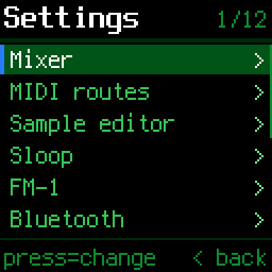 | 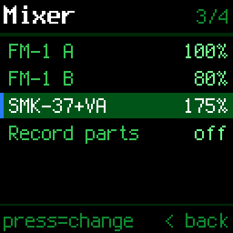 | 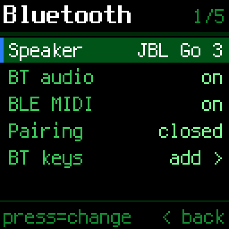 |
| **The 1.3" LCD's HOME** (drawn at 120, shown at 240; not tried on a real one yet) | **The screen picker** | **On the OLED** |
| 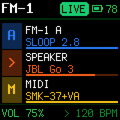 | 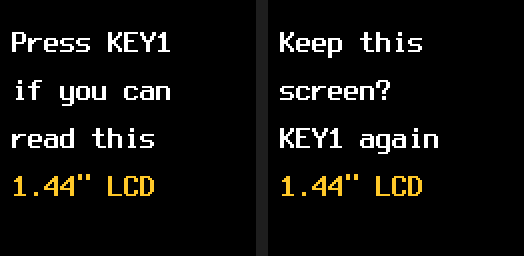 |  |

*Drawn by the Companion's own code on a computer (`tools/render_screens.py --lcd`).*

- **Any Pi Zero with wireless:** the Zero W, Zero WH or Zero 2 W (the Zero 2 W not tried yet). A Pi Zero without
  wireless has no Bluetooth: the installer stops and says so, and the box says so on its screen.
- **Three screen HATs:** the 1.3" OLED (and, found by itself, the same OLED switched to I2C: not tried yet), the
  1.44" LCD, and the 1.3" LCD (ST7789, 240×240): every colour screen drawn at 120 and shown at twice the size.
  *The 1.3" LCD hasn't been tried on a real one yet:* its colours, orientation and edges may need adjusting.
- **Picking the screen:** `install.sh` asks which HAT is fitted. *Not sure* starts the screen picker on the first
  boot: each screen in turn says "Press KEY1 if you can read this", then asks to keep it (a second press), so a
  press that lands a moment late can't pick a screen you can't read. Holding KEY1 and KEY3 at power-on opens it
  again; `fm1-screen oled|lcd144|lcd13|ask` sets it over SSH. A box set to the 1.44" with v2.10 keeps it.
- **`fm1-report`:** the board, OS, version, screen, SPI / I2C / Bluetooth, the speaker and the log in one block, to
  paste into an email or [a hardware report](https://github.com/xoxoaudiolabs/FM-1-Companion/issues/new?template=hardware-report.yml).
- **The installer checks first:** Bluetooth, Raspberry Pi OS Bookworm or Trixie, 1 GB free; it prints the board, OS
  and screen at the end.
- **Settings tidied:** it opens with **Mixer** (each source's level by name, and Record parts: moved from Audio),
  **MIDI routes**, **Sample editor**, **Sloop**, **FM-1** and **Bluetooth** (the speaker, BT audio, BLE MIDI,
  Pairing and BT keys, moved from Audio and MIDI); then Playing, Audio, MIDI, Recordings, Theme and Wi-Fi.
- **Docs:** a Compatibility section (tested, should work, won't), a Bluetooth section (what it does and doesn't,
  delays, the shared radio; the Pi offers SBC, aptX, aptX HD, LDAC and Opus, and the headphones pick),
  [HARDWARE.md](../HARDWARE.md) and a GitHub hardware-report form.

## Pocket v2.10: a colour screen

| HOME | Settings › Theme | A meter |
|---|---|---|
| 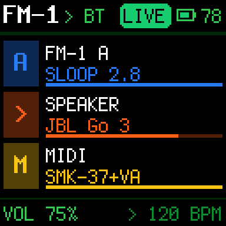 | 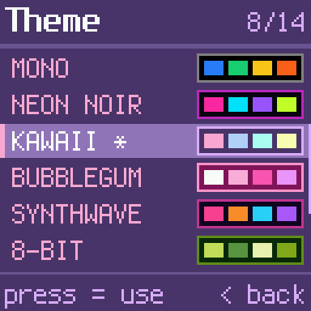 | 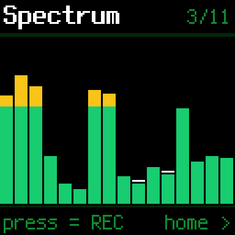 |

*Drawn by the Companion's own code on a computer (`tools/render_screens.py --lcd`). Seen on the real Pocket's LCD
with an FM-1 plugged in.*

- **The Waveshare 1.44" LCD HAT** (128×128 colour, ST7735S) as well as the 1.3" OLED, with the same keys and
  joystick. The Pi can't ask a HAT which one it is, so it's a setting:
  [the setup guide](../fm1-bt-bridge/README.md#set-up) has the one line that switches it.
- **Every screen redrawn for it, with the Studio's look:** SLOOP's colours and its Terminus font. HOME has FM-1 A,
  the speaker and MIDI as rows like the Studio's. Lists show six rows where the OLED shows three. The MIDI routes,
  the sample editor (its selection, markers and fades in colour), the screensaver and the start-up screen are
  redrawn too.
- **The eleven meters redrawn** in colour: levels green, yellow from −12 dBFS, red from −6.
- **Settings › Theme:** FM-1 A's colours (as SLOOP's MENU › COLOR shows them, a theme made in SLOOP's editor
  included), SLOOP's five palettes, or the Studio's eight themes (NEON NOIR, KAWAII, BUBBLEGUM, SYNTHWAVE, 8-BIT,
  INFERNO, TOXIC, DEEP SEA). The screen shows each one as you scroll to it.
- **The OLED's screens are unchanged:** every one, the meters included, draws the same as in v2.9, pixel for pixel
  (compared on a computer).

Every screen on the LCD, the meters, and HOME in each theme

| | | |
|---|---|---|
| 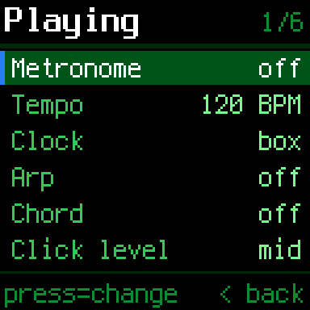 | 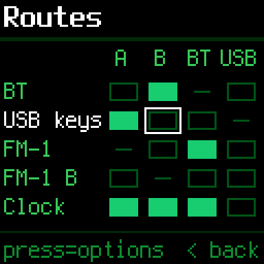 |  |
| Settings: Playing | MIDI routes, two FM-1s | The mixer |
| 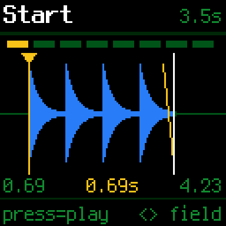 | 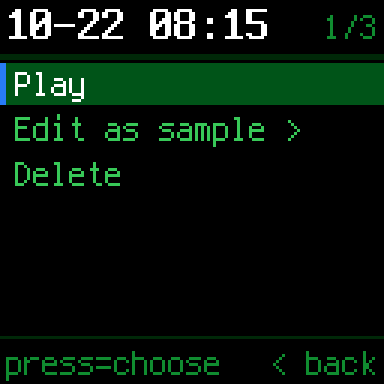 | 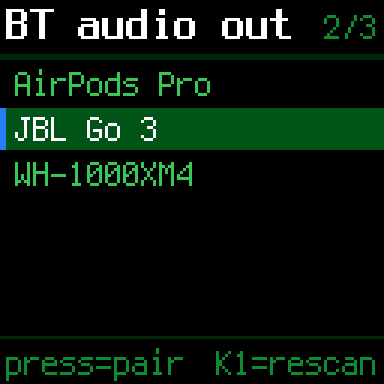 |
| The sample editor | A recording | Speakers found by a scan |
| 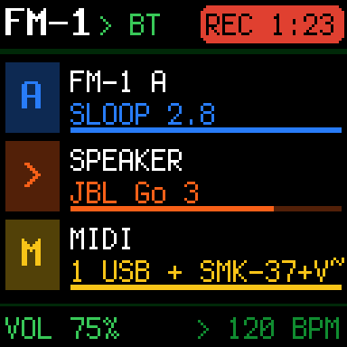 | 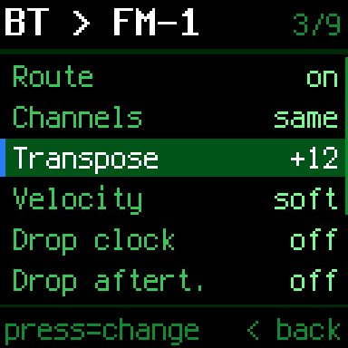 | 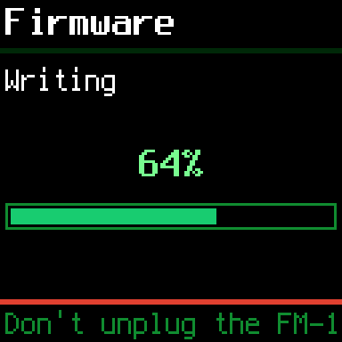 |
| Recording: REC and the time | A route's options | A SLOOP update running |

**The eleven meters** (joystick left from HOME; up/down changes meter, press records)

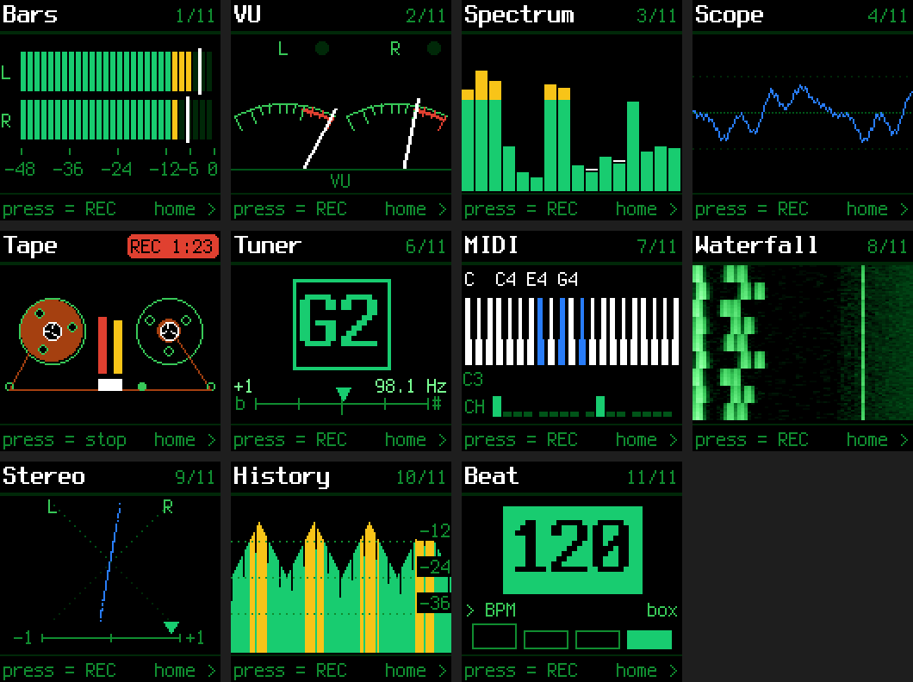

**HOME in each theme:** SLOOP's five, then the Studio's eight

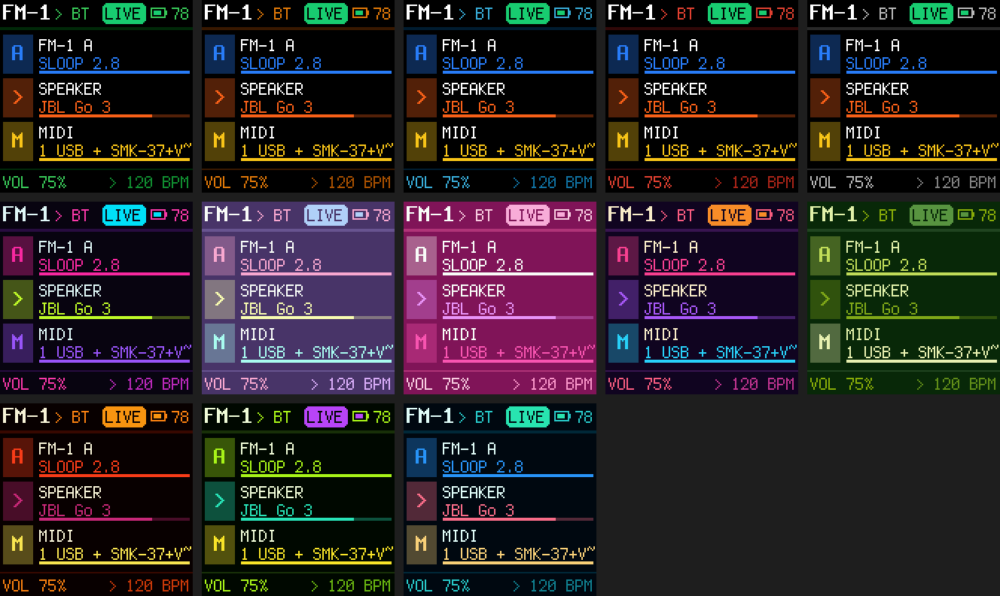

## Since Studio v1.6 (on main, not a numbered release yet): MIDI recording, an 808 kit, a speaker that comes back

- **MIDI recording:** each take the RECORDER makes now has a `.mid` beside its WAV, of the same name: the MIDI
  played into the box while it recorded, a track for each source (FM-1 A, FM-1 B, each USB keyboard by its own
  name, Bluetooth MIDI, Network MIDI), at the box's tempo when the take started. Its time 0 is the WAV's first
  sample, so both drop into a DAW lined up. A take recorded off the mixer (the usual one on the Studio: more than
  one source, the speaker) has its notes moved 72 ms later, the time its sound takes to get through the mixer into
  the take, measured on the Studio. Left out: clock and transport, SysEx, and an FM-1's channel 16 (its REMOTE
  OUT, the panel driving SLOOP or X0X). A note still held at the end is let go there. With nothing played, no
  `.mid` is made.
  - The tempo written in the file is the box's own (its clock, or the tempo setting): one an FM-1 plays at
    without the box following its clock isn't the file's, so the bars in a DAW won't match it (the notes are still
    at their times).
- **A ready-made 808 KIT for the sampler** (PADS › KITS), there the first time KITS opens: sixteen recordings of a
  real Roland TR-808 by Michael Fischer (1994, CC0 1.0), on SLOOP's drum keys
  ([where each comes from](../fm1-bt-bridge/kits/808/CREDITS.md)).
  - Its sounds go into the samples folder (listed after your own) and can be moved, trimmed or swapped like any
    other. Deleted, the kit isn't made again, and a sample of the same name you have already is left alone.
  - Not affiliated with Roland: TR-808 is Roland's trademark.
- **KITS scrolls** (^ v) when there are more than four.
- **A speaker that comes back by itself is reconnected once:** switched on, a Bluetooth speaker calls the box it
  knows, and once (a JBL Go 3 on the Studio) that connection came up silent: connected, the box playing to it,
  nothing heard. So when the speaker connects by itself (not by the box's own connect), the box disconnects it and
  connects it again a few seconds in: a moment of silence, then sound. Never during a recording.
- **A source or speaker back after a short drop is heard again at once:** an FM-1 off USB for a few seconds (or a
  speaker reconnected) comes back as a new PipeWire node of the same name, and its sound path stayed unlinked: FM-1
  A's sound took 90 s to come back after a 5 s drop. Each sound path now notices its ends came back anew and is
  made again within the next look at PipeWire (about 2 s).

## Studio v1.6: DJ decks

| The DECKS screen on the real Studio (a capture of its screen), two tracks synced | MORE › DJ DECKS |
|---|---|
| 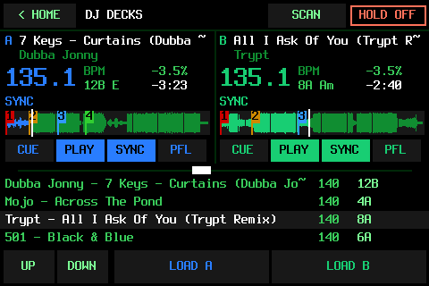 | 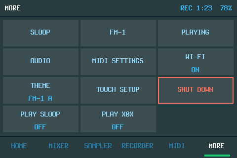 |

**MORE › DJ DECKS**: two DJ decks on the Studio, played from a **Hercules DJControl Inpulse 200 MK2** (the controller
they were made and tried with) and from the touchscreen.

- **The music:** `~/fm1-library/Studio DJ Music` (MP3, FLAC, WAV, AIFF, Ogg). **SCAN** reads each new track's
  title, artist, BPM, key (also as Camelot) and beatgrid from its tags, including what Serato DJ saved in it (its
  BPM, key, beatgrid and hot cues, in MP3 files), and works out the BPM, key and beat from the sound where the tags
  lack them, about 10 seconds a track on the Pi 3. Serato's stems files (`.serato-stems`) are Serato's own
  protected format and aren't used.
- **Each deck:** play, CUE as on a CDJ (stopped: it sets the cue and plays while held; PLAY tapped while CUE is held
  keeps it playing), the tempo fader (±8 %, up is slower), the jog wheel (VINYL off, as the decks start: it moves
  through the track and nudges; VINYL on: it scratches), 4 hot cues (pads in HOTCUE mode; SHIFT + pad deletes one),
  loops (LOOP IN: 4 beats from the nearest beat, LOOP OUT, SHIFT halves or doubles), loop rolls (pads in ROLL mode:
  1, 2, 4 or 8 beats while held, then on from where the track would have been), gain, LOW and HIGH EQ, a filter,
  the volume fader, PFL (the headphone button) and the crossfader.
- **SYNC** locks a deck to the other: its tempo and its beat, kept together while both play (a double or half tempo
  where that's nearer: a track tagged 70 BPM locks to one at 140). With both synced, the tempo fader moved last
  leads. Each track's beatgrid is moved onto its own kicks when it loads (a grid can sit some ms off them), and a
  nudge with the jog on a synced deck is kept.
- **The screen:** both decks (title, artist, BPM, key, time left, tempo, SYNC / LOOP), each track's waveform
  overview with where it's at and its hot cues (a line in the cue's colour with its pad's number: tap the number to
  go there, hold it to delete the cue; tap the waveform to go there), the crossfader, and the track list (the row
  the browser knob is on lit; LOAD A, LOAD B). < HOME goes back with the decks playing on; HOLD OFF stops them.
- **Sound:** the master to the Studio's Bluetooth speaker (with none, the Hercules's master out); the headphones
  (PFL) to the Hercules's own sound card: **the Hercules has its own sound card** (4 channels: master out and
  headphones), and its MASTER and HEADPHONES knobs work on it in its own hardware.
- **It remembers:** each track's hot cues and CUE point as set or deleted on the Studio (in
  `.studio-dj-memory.json` beside the music: nothing is written into the music files or their Serato tags), and the
  session: the decks come back loaded and paused where they were, with their tempo, SYNC, PFL and pad mode.
- **The Hercules belongs to the decks:** it's left out of the MIDI routes (its pads don't play the FM-1s).
- Not affiliated with Serato or Hercules: the decks read the cue points and beatgrids Serato DJ saves in a track's
  tags; Serato is a trademark of its owner.

## Studio v1.6: CUE for SLOOP and X0X

- **CUE for SLOOP and X0X:** their MIXER columns have a CUE button too (on the 3.5 mm jack, as the FM-1s'; theirs
  after their fader, the others' before it).

## Studio v1.6: SLOOP and X0X together, in time

- **Both at once.** Opening PLAY X0X no longer stops SLOOP, or the other way round: one is on the screen, the other
  keeps playing behind it. MORE says ON for each one running; HOLD OFF stops only the one on the screen.
- **One clock.** The Companion connects each app's MIDI clock to the other, as two FM-1s cabled both ways. SLOOP
  leads by default (its CLK OUT starts ON on the Studio): PLAY on SLOOP starts both from the top, its tempo is
  both apps' tempo, STOP stops both; X0X shows its tempo in amber while it follows. To have X0X lead, set SLOOP's
  GLO › SYSTEM › SYNC to USB (SLOOP keeps both settings now). An app follows the other's clock only while the
  other plays, so one playing on its own isn't pulled off its beat when the other opens.
- **FM-1 A's own clock** is no longer passed to the apps, so it can't fight theirs.
- **Backups of the Studio's apps.** Settings › Sloop has a **For** row: **FM-1**, **SLOOP Studio** or **X0X
  Studio**.
  - **SLOOP Studio:** the Studio's SLOOP now keeps everything an FM-1's SLOOP keeps (its settings, the working
    project, the four project slots, the song's sections, user presets, the FM6 patches, the four sample slots),
    and Back up now, Restore, Load project and Load sample work on it as on an FM-1: the same jobs, the same files
    in `~/fm1-library`, so a backup of FM-1 A restores onto the Studio's SLOOP and the other way round. SLOOP has
    to be open (PLAY SLOOP) for them. Auto backups and the web page's requests still go to the FM-1.
  - **X0X Studio:** Back up now saves X0X's project as a `.x0b` in `~/fm1-library/x0x/`, X0X's own backup format
    (the one its backup page makes from an FM-1). Restore puts one back: X0X is stopped first (it saves), what it
    held is backed up first, and PLAY X0X opens it. Its break loops aren't in it (the Studio's X0X has none yet).
- It needs both apps rebuilt from their repos' current main (their `studio/` READMEs).
- **Tried:** by hand from FM-1 A, SLOOP leading; by a script, both directions; the backups by script on the
  Studio, not yet by hand. Details and what isn't tried yet: [Tested on the real hardware](../README.md#the-studio).

## Studio v1.5: X0X on the Studio

| X0X on the Studio (X0X's picture captured on the real Studio; the margins drawn by the Companion's code) | MORE › PLAY X0X, and X0X's level in the MIXER |
|---|---|
| 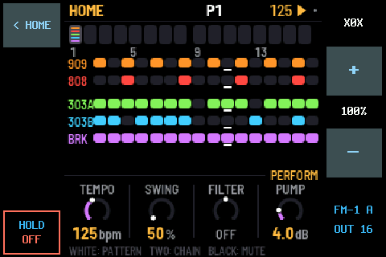 |   |

[X0X](https://github.com/charlesvestal/fm1-x0x), Charles Vestal's groovebox firmware for the FM-1 (909, 808, two
303s with TB-3PO, a breakbeat player, song mode), running on the Studio itself, not emulated: its own code, built
for the Pi the way X0X's browser version is built. Its repo:
[X0X for the FM-1 Companion Studio](https://github.com/xoxoaudiolabs/fm1-x0x-companion-studio).

- **Played from the same FM-1 A** as SLOOP on the Studio: SLOOP Remote Out with REMOTE on **OUT 16**. X0X's panel
  is the FM-1's, so every control does what it does on an FM-1 running X0X.
- **MORE › PLAY X0X**, **< HOME**, **HOLD OFF**, its + / − and its MIXER channel work as SLOOP's do. In v1.5 one
  app runs at a time: starting X0X stops SLOOP (it saves first), and the other way round. From v1.6, both run at
  once with a shared clock (above).
- **It keeps what X0X saves** (settings, sounds, patterns, song) in a file of its own, loaded when it starts.
- **REMOTE OUT sends every knob now** (SLOOP Remote Out, updated): every turn of the seven knobs, on any page, and
  MASTER as CC 123, so the Studio's apps get the whole panel, not only what FM-1 A's own SLOOP page uses.
- **The recorder's clip warning no longer fires on deep sub-bass** (an 808 at 30–50 Hz has slow, flat-looking
  peaks): a take counts as clipped only when many of its peaks are cut off at the same level.

**Setting it up:** FM-1 A as for SLOOP below (steps 1 and 2), then on the Studio build and install X0X's
[`studio/`](https://github.com/xoxoaudiolabs/fm1-x0x-companion-studio/tree/main/studio) program (its README; about
1.5 minutes on the Pi). MORE then shows **PLAY X0X**.

**Tried on the real Studio:** X0X opened from PLAY X0X and played by hand from FM-1 A; stress tests by a script
(X0X alone, and X0X next to SLOOP), with no dropouts or audio errors. The details, and what hasn't been tried yet,
are in [Tested on the real hardware](../README.md#the-studio).

## Studio v1.4: SLOOP on the Studio

| SLOOP running on the real Studio (a capture of its screen) | MORE › PLAY SLOOP, and SLOOP's level in the MIXER |
|---|---|
| 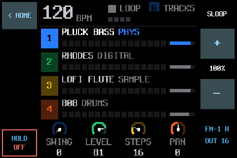 |   |

[SLOOP](https://github.com/isod89/sloop-fm1) running on the Studio itself, not emulated: its own sound engines,
sequencer and screens, compiled from its sources for the Pi through the harness its own tests use. On one of the
Pi 3's four cores, SLOOP's heaviest test case (a physical-model cello, 8 notes, and drums) takes about 8%.

- **Played from a real FM-1.** FM-1 A runs SLOOP with a REMOTE OUT added
  ([SLOOP Remote Out](https://github.com/xoxoaudiolabs/sloop-remote-out), from SLOOP 2.8.1):
  with GLO › MIDI 3 › REMOTE on **OUT 16**, its 14 buttons, 7 knobs and 27 keys also go out on MIDI channel 16, and
  the Companion passes them to SLOOP on the Studio. FM-1 A keeps playing its own SLOOP too: turn it down in the
  MIXER to hear only the Studio's.
- **MORE › PLAY SLOOP** turns it on (the tile says ON or OFF). SLOOP's picture fills the middle of the screen.
  **< HOME** (top left) goes back to the Companion with SLOOP still running, and playing if it was; PLAY SLOOP
  brings it back as it was. **HOLD OFF** (bottom left, held a second) saves and stops it.
- **Its own level:** + / − in the right margin while it plays, and a SLOOP channel in the MIXER, 0–200%.
- **It keeps its project:** the working project (tracks, sounds, steps, the song's settings, in SLOOP's own format)
  is saved a few seconds after a change and when it stops, and loaded when it starts.
- **In v1.4, not saved:** SLOOP's four project slots, user presets and sample slots lasted only while it ran.
  From v1.6 they're kept.

**Setting it up:**
1. Install SLOOP with REMOTE OUT on FM-1 A: build it from [SLOOP Remote Out](https://github.com/xoxoaudiolabs/sloop-remote-out)
   (as SLOOP builds: its [BUILDING.md](https://github.com/xoxoaudiolabs/sloop-remote-out/blob/main/BUILDING.md)),
   put the `.fwsc` in the library's firmware folder and install it from MORE › FM-1 › Install firmware (it backs
   the FM-1 up first). The official SLOOP goes back on the same way.
2. On FM-1 A: hold GLO, MIDI 3, turn REMOTE to **OUT 16**.
3. On the Studio: build and install its [`studio/`](https://github.com/xoxoaudiolabs/sloop-remote-out/tree/main/studio) program (its README;
   about 2 minutes on the Pi). MORE then shows **PLAY SLOOP**.

## Pocket v2.9 (and the Studio): Bluetooth MIDI keyboards

*Built, with automated tests, but not tried with a real keyboard or two real devices yet.*

| Settings › MIDI › BT keys (drawn by the Companion's code) |
|---|
|  |

- **Keyboards that wait to be connected to** (a microKEY Air, a WIDI): Settings › MIDI › **BT keys** scans for
  Bluetooth MIDI and connects to the one you pick. Up to four are saved and connected again whenever they're on.
- **Several Bluetooth MIDI devices at once:** phones, tablets, computers and those keyboards, all the matrix's
  Bluetooth row and column. Each device's MIDI is read on its own, so in the automated tests two playing at once
  don't mix up their notes.

## Studio v1.3

The first release made on the real Studio, with a sampler, a recorder and headphones.

| The sampler: 16 pads in a kit | SLOOP's sequencer for the pads |
|---|---|
|  |  |
| **Sixteen of SLOOP's punch-in FX** | **The recorder** |
|  |  |

- **SAMPLER.** 16 pads in kits (MPC notes 36-51, or SLOOP's drum layout so SLOOP's own sequencer plays them),
  sampled from any source, trimmed in the touch **EDITOR** (OPEN lists your samples and takes, TO PAD puts the
  edit on a pad). **SEQ**: SLOOP's drum sequencer, up to 64 steps a pattern with levels, ratchets, nudge, swing
  and live REC. **RPT**: note repeat. **FX**: sixteen of SLOOP's punch-in FX on the pads, held or latched.
- **RECORDER**, its own tab: the reel-to-reel deck, REC, Record parts and your takes.
- **Headphones.** The Pi's 3.5 mm jack: speaker, jack or both; a PHONES fader; a CUE button on each source
  (heard on the jack before its fader) and a cue/main blend, as on a DJ mixer.
- **Every USB MIDI device on its own.** The MIDI routes give each one a row and a column by name (an SMK-37,
  a K.O. Sidekick), remembered when it's unplugged. All four USB ports carry audio and MIDI at once; a second
  device of the same model is numbered.
- **An FM-1 keeps the clock.** With several USB audio devices, an FM-1 is the one the others are re-timed to:
  a keyboard's synth taking it over made the headphone jack drop out and everything crackle.
- **New screens:** a boot screen from power-on to HOME, a touch setup on first start, a cleaner tab bar
  (HOME, MIXER, SAMPLER, RECORDER, MIDI, MORE; METERS under MIXER, DAW under MIDI), MORE as tiles, smoother
  meters, an HDMI mirror of the screen.
- **Made for the real hardware:** the screen driver Raspberry Pi OS ships now (piscreen, at 24 MHz), touch
  calibration, the PiSugar 3 Plus, an SMK-37 running Clipper told apart from an FM-1.

| The boot screen | The MIDI routes, a device each |
|---|---|
|  |  |

**Connecting a DAW:** on the computer, open network MIDI (Mac: Audio MIDI Setup › MIDI Studio › Network;
Windows: the free rtpMIDI driver) and connect a session to each of the Studio's two ports. In Kraken, set the
port connected to "FM-1 Companion MCU" to Mackie; in Live, choose MackieControl as a control surface on that port.

## Pocket v2.8

| Two FM-1s in the MIDI routes | The mixer |
|---|---|
|  |  |

- **Two FM-1s at once,** named A and B by their hub port, each with its own row and column in the MIDI routes.
- **An audio mixer:** each sound source at its own level, 0–200%, added up before Bluetooth.
- **Record parts (v2.8.1):** each source as its own file next to the mix, from one recording, so they line up to
  the sample.
- **Faster:** one connection to the audio system kept open, about half the CPU it took before.

Release history

**Studio**
- **v1.6:** DJ decks played from a Hercules DJControl Inpulse 200 MK2; SLOOP and X0X at once with one clock;
  backups of the Studio's SLOOP and X0X; CUE for SLOOP and X0X (above).
- **v1.5:** X0X on the Studio, played from FM-1 A; the recorder's clip check left deep sub-bass alone (above).
- **v1.4:** SLOOP on the Studio, played from FM-1 A (above).
- **v1.3:** the sampler (16 pads, SLOOP's sequencer, punch-in FX), the RECORDER tab, the headphone jack with cue,
  every USB MIDI device routed on its own (above).
- **v1.2:** every screen drawn for touch (settings, lists, route details, jobs), hold to confirm anything that
  writes to the FM-1, the sample editor by touch, Wi-Fi and Shut down in MORE.
- **v1.1:** network MIDI (RTP-MIDI) with a music port and a Mackie Control port; the DAW tab for Kraken (Ableton
  Live untested); every USB audio device on its own named mixer channel, with an input pair for multichannel
  interfaces.
- **v1.0:** the Studio's first release: tabs along the bottom, SLOOP's font, palettes and track colours,
  following FM-1 A's colour theme, the meters redrawn in colour (ten: no tuner), the card slot's pin map and
  card ID plan (the box doesn't read the ID yet; the cards' plans now live with the cards' own project).

**Pocket**
- **v2.8.3:** the shared fixes of Studio v1.3 (an SMK-37 running Clipper next to an FM-1 is a keyboard, not a
  third FM-1; FM-1 A's MIDI found by its sound card).
- **v2.8.2:** a long USB device name in Settings › Audio no longer runs into its level on the OLED.
- **v2.8:** two FM-1s, the mixer, a much lighter audio connection. **v2.8.1:** Record parts.
- **v2.7:** USB MIDI keyboards through a hub, found by themselves; the FM-1 can be replugged on the hub without a
  reboot (v2.7.1).
- **v2.6:** PiSugar 3 battery support (charge on screen, a warning at 15%, a safe shutdown at 5%); a new demo
  video; a warning when a recording clipped (v2.6.2).
- **v2.5:** the sample editor, on the box and in the web app.
- **v2.4:** settings in sections, a bigger web app, route presets by name, faster sample loads.
- **v2.3:** six more meters, the Recordings menu, metronome, arp and chord memory, faster screens.
- **v2.2:** recording to WAV, the Tape meter, MIDI clock and the MIDI matrix.

