# What's new in the FM-1 Companion

Every Pocket release, newest first. [Back to the main page](../README.md)

The Studio has moved on: it is [XOXO Studio](https://github.com/xoxoaudiolabs/XOXO-Studio) now, with an FM-1
Companion plug-in. Its releases here (Studio v1.0 to v1.6) are listed under Release history at the end.

## Pocket v3.1: MIDI files, two FM-1s side by side, a USB Bluetooth adapter

- **MIDI files from the SD card.** Put `.mid` files in the card's `fm1-library/midi` folder (or upload them on
  the web page) and play them into the FM-1 from **Library › MIDI files**, at the file's own tempo. While one
  plays, it's first in the list: press it to stop. The web page plays them once or on a loop, shows what's
  playing and stops it. A file's notes, controllers and program changes go out on its own channels; its SysEx
  doesn't, so a file can't change the FM-1's patches. Stopped or at its end, every note is let go.
- **Two FM-1s on a hub, treated alike.**
  - The start-up backup backs up **every** FM-1 plugged in, one after the other (one that fails doesn't stop
    the other), and again for an FM-1 plugged in later. It only counts as done when it worked: a failure is
    tried again a minute later, three times.
  - Each FM-1's firmware is known on its own, so the screen no longer shows FM-1 A's firmware for FM-1 B, or
    last time's for an FM-1 that has changed.
  - With two FM-1s, a backup's name says which one it came from (`…_fm1-b_auto.json`), and timed backups are
    compared with that FM-1's own last one.
  - The web page's Status shows what each runs (`A: SLOOP 2.8.4 · B: FM-1+VA 102`); its Library has an
    **FM-1 A/B** picker for backups, loads, samples, DX7 patches and MIDI files, and **Back up all**.
  - A firmware install still needs one FM-1 at a time (mid-update the FM-1 restarts as another device); it now
    says which one to unplug.
- **The MIDI routes in one order** across and down: FM-1 A, FM-1 B, Bluetooth, USB, Network (and the box's
  clock last, down only). The box's grid opens on Bluetooth › FM-1.
- **A USB Bluetooth adapter:** while one is plugged in, everything Bluetooth moves to it, and back to the Pi's
  own when it's unplugged. `fm1-report` lists the adapters.
- **Settings › Bluetooth › BT devices** lists what's paired or connected (speakers, Bluetooth MIDI keyboards,
  phones); hold press to forget one. A speaker scan lists only what it hears, and pairing a speaker that only
  advertises now and then works.
- **Plugging an FM-1 in while the box runs:** use a cable of about 1 m (3 ft) or longer, or a hub with its own
  power supply. A 6-inch cable can let the FM-1's surge of current as it's plugged in reset the Pi
  ([HARDWARE.md](../HARDWARE.md)).
- *Not tried on a real Pocket yet:* MIDI file playback, and the two-FM-1 backups and labels (automated tests
  only). The USB Bluetooth adapter switch was tried with a TP-Link UB500, not yet with a speaker or a keyboard
  on it.

## Pocket v3.0: ten FM-1 firmwares in the library, Settings in seven pages

| Settings | Library | The FM-1's page, for Felucca |
|---|---|---|
|  | 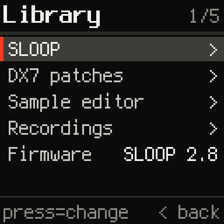 | 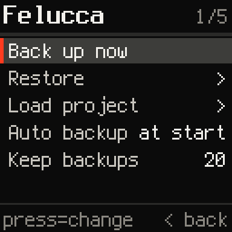 |

*Drawn by the Companion's own code on a computer (`tools/render_screens.py --lcd`).*

- **The library, whatever the FM-1 runs.** The box asks the FM-1 what it runs and backs it up the way that
  firmware's own editor does, into its own backup files where it has them, so they open there too:
  - **SLOOP**, as before; **Clipper** and **sloopDX** the same way, sloopDX with all 8 of its DX7 banks (it's
    stepped through them, then set back; stop the song first), and a DX7 bank file loads into its bank in use.
  - **Felucca**, **JIANT FM** (every song it keeps) and **Melodee** (every project): Felucca's backup files.
  - **Jangada**: its own backup files; DX7 patches go to it, as to Melodee.
  - **X0X**: its project as a `.x0b`, the file X0X's backup page uses; X0X asks on its own screen before a
    restore. Not its break loops.
  - **Baud Girl's FM-1+VA**: its 128 presets, each read back after it's written. From what the community worked
    out of her web tools (her firmware isn't open), so an update of hers may change it. Not its patterns.
  - **M-VAVE's stock firmware**: *Save FM-1 sound* keeps the sound it plays now as a DX7 voice. A whole DX7 bank
    replaces 32 of its presets, and its factory reset doesn't bring the factory ones back: the box says so first.
  - A backup made for one firmware is never put onto another, and a firmware the box doesn't know gets nothing
    written to it.
  - *Only SLOOP has been tried on an FM-1 so far:* the others are built from each firmware's published protocol
    and tested against stand-ins.
- **Settings in seven pages:** **Mixer** (the levels, Record parts, Audio rate), **Playing**, **MIDI**,
  **Bluetooth**, **Studio link**, **Library** (the FM-1's page, DX7 patches, Sample editor, Recordings, Firmware)
  and **Box** (Import SD card, Theme, Wi-Fi). The FM-1's page is named after what it runs and shows only what the
  box does for it.
- **Keep backups:** how many of the box's own backups are kept (automatic, and those before a restore or a load),
  1–100, 20 at first; lowering it deletes the oldest at once. Yours from Back up now are never deleted.
- **The web app's Projects list** shows the newest backup's projects, with the older ones a press away (every
  restart's backup had added more).
- **DX7 patches** go to the FM-1 that takes them when two are plugged in, not to the one running SLOOP.
- **On its own with a USB audio interface:** with no speaker, the Pocket plays through a USB audio interface
  plugged into it.

## Pocket v2.13: splits and key ranges, the XOXO themes, a steadier Studio link

| A route: a key range and a split | Settings › Theme | HOME in each theme |
|---|---|---|
| 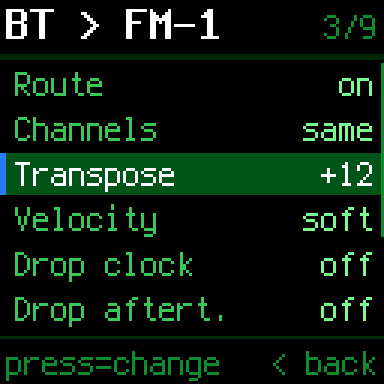 | 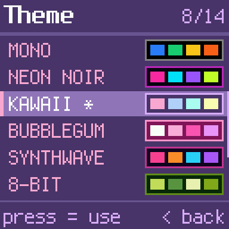 | 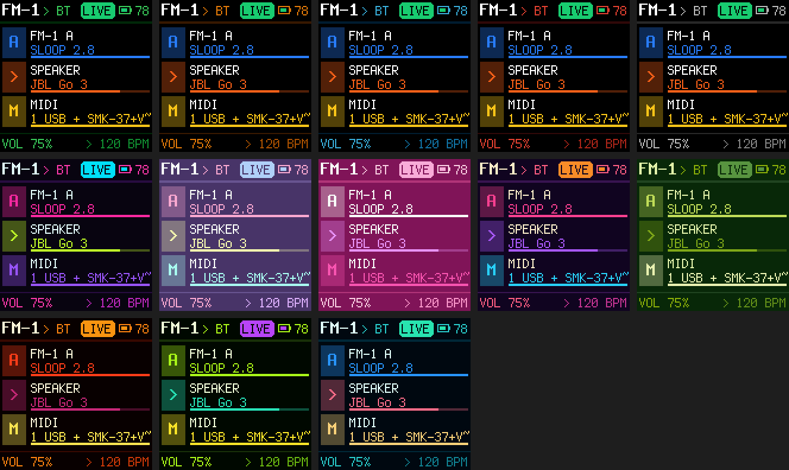 |

*Drawn by the Companion's own code on a computer (`tools/render_screens.py --lcd`).*

- **Splits and key ranges in the MIDI matrix.** Each route has new rows:
  - **Lowest key** and **Highest key:** the keys it passes. Two routes from one keyboard with different keys split
    it across destinations: the bottom to FM-1 A, the top to FM-1 B.
  - **Split at** and **Upper ch.:** from that key up, notes go out on another channel, for two sounds from one
    keyboard on the same FM-1. A chord follows the key you played.
  - **Velocity › scale:** 50–200% on the box, any 10–200% in the web app.
  - **The arpeggiator:** 1/16T and 1/32 as well, up to 4 octaves, and **Arp hold**: it keeps playing after you let
    go, until you play a new chord.
  - On the key rows, left/right while changing moves an octave. The web app's route editor has them all.
  - Tried on the 1.44" LCD Pocket: the new options saved and read back, a wrong value refused, a split saved from
    the web app. *Not tried yet:* playing notes through them on a keyboard.
- **The XOXO themes.** On the colour screen, **Settings › Theme** (and the web app's Screen theme) lists **FM-1 A**
  first, as before, then **XOXO**, black, off-white, warm grey and red-orange, and the eight Studio themes, with
  warmer greys. SLOOP's five palettes are still shown by following FM-1 A; a Pocket set to one of them, and
  FM-1 A's choice before the FM-1 has been read, show XOXO. Tried on the 1.44" LCD.
- **A steadier Studio link.**
  - When the Pocket's sound stream to the Studio restarts, the Pocket's sound joins it again by itself (it could
    stay silent until the Companion restarted). Tried over the cable: back on the Studio within 5 s.
  - When the Studio restarts, the Pocket notices and links again. *Automated tests only so far;* until it's tried,
    **MIDI › Studio link** off and on again does the same.
- Routes saved by an older version, with the chord or arp set to off, no longer make every route change in the
  web app fail.

## Pocket v2.12: a Studio link, one-click updates, a new web app, SLOOP songs

| MIDI › Studio link | Sloop › Load song | FM-1 › DX7 patches: a bank's voices |
|---|---|---|
| 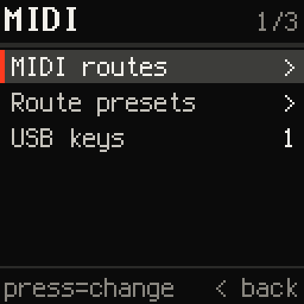 | 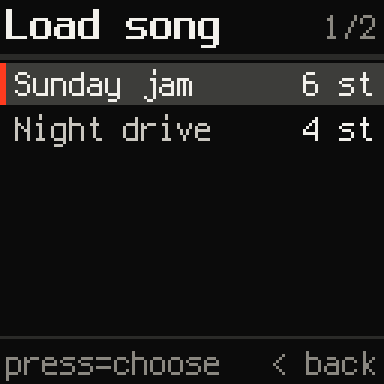 | 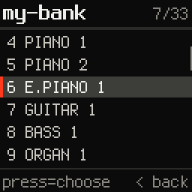 |

*Drawn by the Companion's own code on a computer (`tools/render_screens.py --lcd`).*

- **The Studio link.** **MIDI › Studio link** links the Pocket to a Studio on the same network, over Wi-Fi or an
  Ethernet cable straight from the HUB HAT to the Studio (no router: both get an address by themselves). It finds
  the Studio by itself and prefers the cable when there is one, moving to it within 30 s when it's plugged in.
  While linked:
  - **MIDI both ways**, as the Pocket's network MIDI (NET in the MIDI matrix).
  - **The Studio's clock:** the Studio leads; the Pocket sends it no clock or start/stop of its own.
  - **The Pocket's sound on the Studio** (**Link audio**, on at first): the Pocket's mix, sent uncompressed. With
    no speaker on the Pocket it's the Pocket's output; with one, a copy. The Studio's Bluetooth speaker takes over:
    the Pocket lets go of its own while linked.
  - The link's Studio side isn't in Studio v1.6: it comes out on 30 October.
  - Tried over Wi-Fi and over a cable: MIDI, the clock, and the Pocket's FM-1 heard on the Studio. *Not tried yet:*
    the cable with Wi-Fi off, the Pocket's Ethernet after a restart, the speaker handing over.
- **One-click updates from the web app.** **Library › Software** shows the version on the box and the newest
  release; **Update** asks the box, which wants its hold-press (as for anything that writes to the FM-1), then
  installs the newest release from GitHub and restarts. Your settings, pairings and library (backups, projects,
  songs, samples, recordings, kits, patches) stay as they are. It won't start during a recording or a library job,
  and if the new version doesn't start, the one from before is put back.
  - A box on v2.11 or older needs this release installed over SSH once; after that the web app does it.
  - Tried: an install from a release file as the updater does it (settings and the library kept), going back, and
    an update turned down with nothing newer. *Not tried yet:* a whole update to a newer release (there isn't one
    yet), the Studio.
- **A new web app**, in the look of xoxoaudiolabs.com, with the Studio link, the screen's theme, auto backup and
  the Bluetooth speaker (connect, disconnect) added. *Tried only in a browser with sample data so far.*
- **SLOOP songs (SLOOP 2.5+).** **Sloop › Back up song** saves the song on the FM-1 as one file: its four sections
  (projects A–D, an empty one too) and the song order (the steps, their sections and bars, and the loop).
  **Load song** puts one back: the sections, and the song order into the FM-1's settings, changing only those
  36 bytes, so its other settings stay as they are. It backs the FM-1 up first and won't while a song plays.
  The web app's Library has the same (**Songs**: back up, load, download, upload). Tried on an FM-1 running SLOOP
  2.8: a song saved, loaded back, read back the same.
- **DX7 patches**, for FM-1 firmwares that take them. `.syx` banks (32 voices) and single voices go in the
  library's `patches` folder (from the SD card, or the web app's **DX7 patches**). **FM-1 › DX7 patches** sends a
  whole bank (the FM-1 asks on its screen where it goes) or one voice by name (a bank's voice unpacked to a single
  voice: for firmwares that take only those). Only the two standard Yamaha messages are sent: never M-VAVE's
  updater messages. It asks first whether the FM-1 runs SLOOP or Clipper, which don't take DX7 patches, and sends
  nothing to them (seen on a SLOOP FM-1). *Not tried yet on a firmware that takes DX7 patches* (by others'
  research: M-VAVE's own, and Baud Girl's FM-1+VA before its FM-1_079): tried one? [Tell us](https://github.com/xoxoaudiolabs/FM-1-Companion/issues/new?template=hardware-report.yml).

## Pocket v2.11: more boards and screens, a tidier Settings

| Settings | Mixer | Bluetooth |
|---|---|---|
| 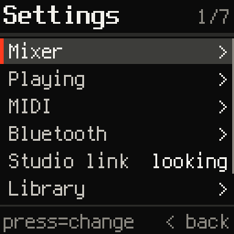 | 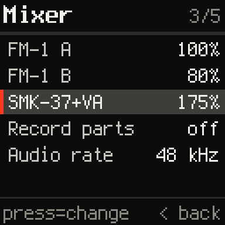 | 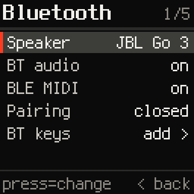 |
| **The 1.3" LCD's HOME** (drawn at 120, shown at 240; not tried on a real one yet) | **The screen picker** | **On the OLED** |
| 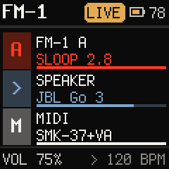 | 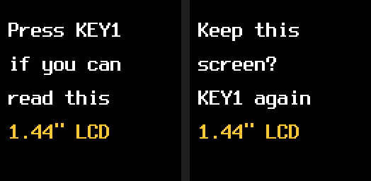 | 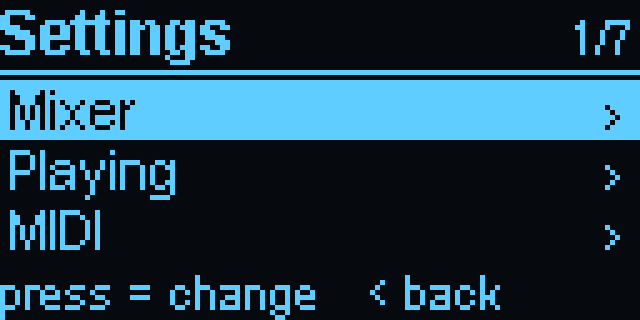 |

*Drawn by the Companion's own code on a computer (`tools/render_screens.py --lcd`).*

- **Any Pi Zero with wireless:** the Zero W, Zero WH or Zero 2 W (the Zero 2 W not tried yet). A Pi Zero without
  wireless has no Bluetooth: the installer stops and says so, and the box says so on its screen.
- **Three screen HATs:** the 1.3" OLED (and, found by itself, the same OLED switched to I2C: not tried yet), the
  1.44" LCD, and the 1.3" LCD (ST7789, 240×240): every colour screen drawn at 120 and shown at twice the size.
  *The 1.3" LCD hasn't been tried on a real one yet:* its colours, orientation and edges may need adjusting.
- **Picking the screen:** `install.sh` asks which HAT is fitted. *Not sure* starts the screen picker on the first
  boot: each screen in turn says "Press KEY1 if you can read this", then asks to keep it (a second press), so a
  press that lands a moment late can't pick a screen you can't read. Holding KEY1 and KEY3 at power-on opens it
  again; `fm1-screen oled|lcd144|lcd13|ask` sets it over SSH. A box set to the 1.44" with v2.10 keeps it.
- **`fm1-report`:** the board, OS, version, screen, SPI / I2C / Bluetooth, the speaker and the log in one block, to
  paste into an email or [a hardware report](https://github.com/xoxoaudiolabs/FM-1-Companion/issues/new?template=hardware-report.yml).
- **The installer checks first:** Bluetooth, Raspberry Pi OS Bookworm or Trixie, 1 GB free; it prints the board, OS
  and screen at the end.
- **Settings tidied:** it opens with **Mixer** (each source's level by name, and Record parts: moved from Audio),
  **MIDI routes**, **Sample editor**, **Sloop**, **FM-1** and **Bluetooth** (the speaker, BT audio, BLE MIDI,
  Pairing and BT keys, moved from Audio and MIDI); then Playing, Audio, MIDI, Recordings, Theme and Wi-Fi.
- **Docs:** a Compatibility section (tested, should work, won't), a Bluetooth section (what it does and doesn't,
  delays, the shared radio; the Pi offers SBC, aptX, aptX HD, LDAC and Opus, and the headphones pick),
  [HARDWARE.md](../HARDWARE.md) and a GitHub hardware-report form.

## Pocket v2.10: a colour screen

| HOME | Settings › Theme | A meter |
|---|---|---|
| 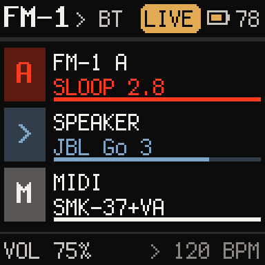 |  | 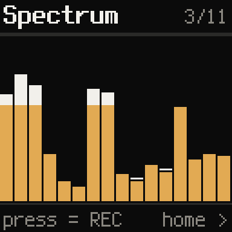 |

*Drawn by the Companion's own code on a computer (`tools/render_screens.py --lcd`). Seen on the real Pocket's LCD
with an FM-1 plugged in.*

- **The Waveshare 1.44" LCD HAT** (128×128 colour, ST7735S) as well as the 1.3" OLED, with the same keys and
  joystick. The Pi can't ask a HAT which one it is, so it's a setting:
  [the setup guide](../fm1-bt-bridge/README.md#set-up) has the one line that switches it.
- **Every screen redrawn for it, with the Studio's look:** SLOOP's colours and its Terminus font. HOME has FM-1 A,
  the speaker and MIDI as rows like the Studio's. Lists show six rows where the OLED shows three. The MIDI routes,
  the sample editor (its selection, markers and fades in colour), the screensaver and the start-up screen are
  redrawn too.
- **The eleven meters redrawn** in colour: levels green, yellow from −12 dBFS, red from −6.
- **Settings › Theme:** FM-1 A's colours (as SLOOP's MENU › COLOR shows them, a theme made in SLOOP's editor
  included), SLOOP's five palettes, or the Studio's eight themes (NEON NOIR, KAWAII, BUBBLEGUM, SYNTHWAVE, 8-BIT,
  INFERNO, TOXIC, DEEP SEA). The screen shows each one as you scroll to it.
- **The OLED's screens are unchanged:** every one, the meters included, draws the same as in v2.9, pixel for pixel
  (compared on a computer).

Every screen on the LCD, the meters, and HOME in each theme

| | | |
|---|---|---|
| 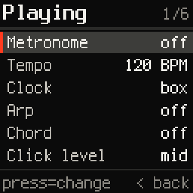 | 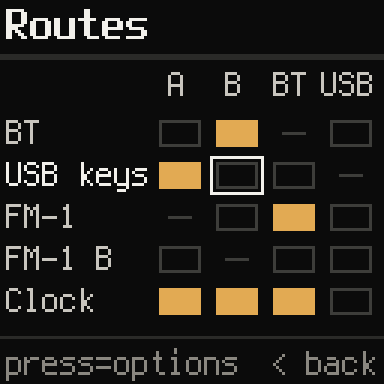 |  |
| Settings: Playing | MIDI routes, two FM-1s | The mixer |
| 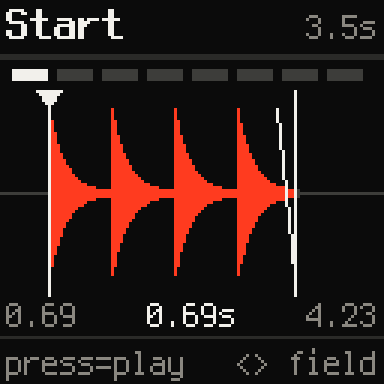 | 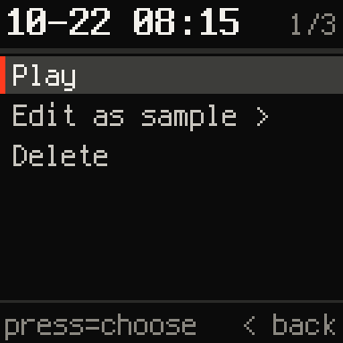 | 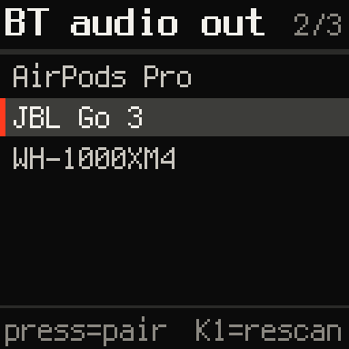 |
| The sample editor | A recording | Speakers found by a scan |
| 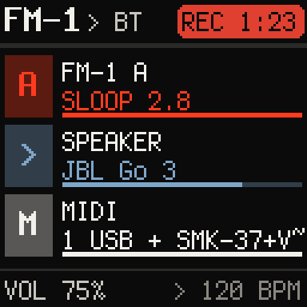 |  | 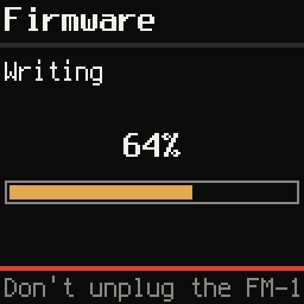 |
| Recording: REC and the time | A route's options | A SLOOP update running |

**The eleven meters** (joystick left from HOME; up/down changes meter, press records)

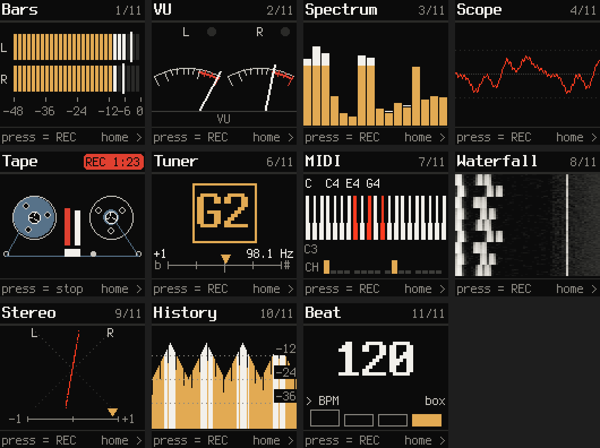

**HOME in each theme:** SLOOP's five, then the Studio's eight

## Pocket v2.9: Bluetooth MIDI keyboards

*Built, with automated tests, but not tried with a real keyboard or two real devices yet.*

| Settings › MIDI › BT keys (drawn by the Companion's code) |
|---|
| 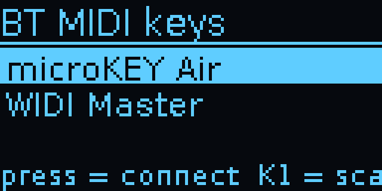 |

- **Keyboards that wait to be connected to** (a microKEY Air, a WIDI): Settings › MIDI › **BT keys** scans for
  Bluetooth MIDI and connects to the one you pick. Up to four are saved and connected again whenever they're on.
- **Several Bluetooth MIDI devices at once:** phones, tablets, computers and those keyboards, all the matrix's
  Bluetooth row and column. Each device's MIDI is read on its own, so in the automated tests two playing at once
  don't mix up their notes.

## Pocket v2.8

| Two FM-1s in the MIDI routes | The mixer |
|---|---|
| 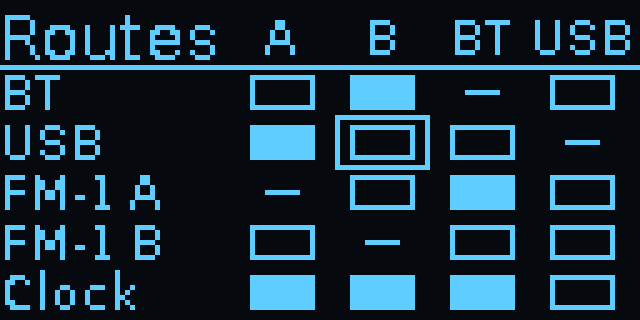 | 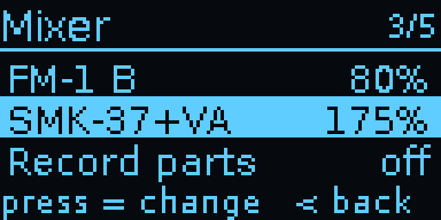 |

- **Two FM-1s at once,** named A and B by their hub port, each with its own row and column in the MIDI routes.
- **An audio mixer:** each sound source at its own level, 0–200%, added up before Bluetooth.
- **Record parts (v2.8.1):** each source as its own file next to the mix, from one recording, so they line up to
  the sample.
- **Faster:** one connection to the audio system kept open, about half the CPU it took before.

Release history

**Studio** (now [XOXO Studio](https://github.com/xoxoaudiolabs/XOXO-Studio))
- **v1.6:** DJ decks played from a Hercules DJControl Inpulse 200 MK2; SLOOP and X0X at once with one clock;
  backups of the Studio's SLOOP and X0X; CUE for SLOOP and X0X.
- **v1.5:** X0X on the Studio, played from FM-1 A; the recorder's clip check left deep sub-bass alone.
- **v1.4:** SLOOP on the Studio, played from FM-1 A.
- **v1.3:** the sampler (16 pads, SLOOP's sequencer, punch-in FX), the RECORDER tab, the headphone jack with cue,
  every USB MIDI device routed on its own.
- **v1.2:** every screen drawn for touch (settings, lists, route details, jobs), hold to confirm anything that
  writes to the FM-1, the sample editor by touch, Wi-Fi and Shut down in MORE.
- **v1.1:** network MIDI (RTP-MIDI) with a music port and a Mackie Control port; the DAW tab for Kraken (Ableton
  Live untested); every USB audio device on its own named mixer channel, with an input pair for multichannel
  interfaces.
- **v1.0:** the Studio's first release: tabs along the bottom, SLOOP's font, palettes and track colours,
  following FM-1 A's colour theme, the meters redrawn in colour (ten: no tuner), the card slot's pin map and
  card ID plan (the box doesn't read the ID yet; the cards' plans now live with the cards' own project).

**Pocket**
- **v2.8.3:** the shared fixes of Studio v1.3 (an SMK-37 running Clipper next to an FM-1 is a keyboard, not a
  third FM-1; FM-1 A's MIDI found by its sound card).
- **v2.8.2:** a long USB device name in Settings › Audio no longer runs into its level on the OLED.
- **v2.8:** two FM-1s, the mixer, a much lighter audio connection. **v2.8.1:** Record parts.
- **v2.7:** USB MIDI keyboards through a hub, found by themselves; the FM-1 can be replugged on the hub without a
  reboot (v2.7.1).
- **v2.6:** PiSugar 3 battery support (charge on screen, a warning at 15%, a safe shutdown at 5%); a new demo
  video; a warning when a recording clipped (v2.6.2).
- **v2.5:** the sample editor, on the box and in the web app.
- **v2.4:** settings in sections, a bigger web app, route presets by name, faster sample loads.
- **v2.3:** six more meters, the Recordings menu, metronome, arp and chord memory, faster screens.
- **v2.2:** recording to WAV, the Tape meter, MIDI clock and the MIDI matrix.

