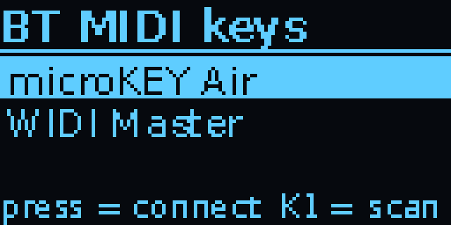

# Setting up the FM-1 Companion

This guide is written for **the Pocket**: a Raspberry Pi Zero W (or Zero 2 W) with a Waveshare Zero screen HAT
([which ones](#compatibility)). **The Studio**
(a Pi 3 B+ with a 3.5" touchscreen) installs the same way, and `install.sh` works out which build it's on; its
touch screens, the sampler, SLOOP and X0X on the Studio and the DJ decks are in the
[main README](../README.md).

The Pocket gives the M-VAVE FM-1 Bluetooth:

- **Audio out:** the FM-1's USB audio goes to Bluetooth headphones or a speaker.
- **MIDI in and out:** the Pi shows up as a Bluetooth MIDI device called **"FM-1 Companion"**. MIDI
  passes both ways between it and the FM-1's USB MIDI, so an iPad, phone or computer can play the
  FM-1 and receive what you play on it.
- **A library for the FM-1 (SLOOP):** back up and restore everything on it, load projects and samples,
  and install firmware updates, from the box or from your phone, with no computer.

Audio and MIDI work with any FM-1 firmware that shows up as a USB audio and MIDI device, such as Sloop.
The library needs SLOOP 2.3 or later (firmware installs work with any `.fwsc` package
SLOOP's installer accepts).

```
                         ┌──Bluetooth A2DP───▶ headphones / speaker
FM-1 ──USB──▶ Pi Zero W ─┤
 (audio + MIDI)          └◀─Bluetooth LE MIDI─▶ iPad / phone / Mac
```

## Compatibility

**Tested by us** (on the real Pocket), and what should work but hasn't been tried yet:

| Board | |
|---|---|
| Pi Zero W (v1.1) | Tested |
| Pi Zero WH | Should work: the same board as the Zero W with its header soldered on |
| Pi Zero 2 W / 2 WH | Should work: not tried by us yet. It's quad-core; the Companion keeps the Zero W's settings on it |
| Pi Zero, Zero 1.3, Zero H | **Won't work:** no wireless, so no Bluetooth. The installer stops and says so |

| Screen HAT (Waveshare, Zero size, with the joystick and three keys) | |
|---|---|
| 1.3" OLED HAT (SH1106, 128×64), on SPI | Tested |
| 1.3" OLED HAT switched to I2C (its resistor jumpers) | Should work: found by itself at 0x3C / 0x3D; not tried yet |
| 1.44" LCD HAT (ST7735S, 128×128 colour) | Tested (v2.10) |
| 1.3" LCD HAT (ST7789, 240×240 colour) | Should work: not tried on one yet (its colours, orientation and edges may need adjusting) |

All three use the same pins for the keys and joystick (KEY1 21, KEY2 20, KEY3 16, up 6, down 19, left 5, right
26, press 13), so they work whichever screen is fitted.

| Raspberry Pi OS Lite | |
|---|---|
| Trixie, 32-bit | Tested (Zero W) |
| Trixie, 64-bit (Zero 2 W only) | Should work: everything comes from Raspberry Pi OS's own packages; not tried |
| Bookworm, 32- or 64-bit | Should work: the installer handles its older WirePlumber; not tried for this release |

**Reported by builders:** none yet. Built one on different hardware, or had trouble? [Tell us](https://github.com/xoxoaudiolabs/FM-1-Companion/issues/new?template=hardware-report.yml) (it asks
for what `fm1-report` prints). What a replacement part needs, and how to add a screen:
[HARDWARE.md](../HARDWARE.md).

## What you need

- A **Pi Zero W** (or Zero WH, or Zero 2 W: [Compatibility](#compatibility)): one with wireless, for Bluetooth
- A **Waveshare Zero screen HAT** with the joystick and three keys: the 1.3" OLED, the 1.44" LCD or the 1.3" LCD
- microSD card (8 GB or more)
- A **micro-USB OTG adapter** and a cable to the FM-1, plugged into the Zero's port labelled **USB**
- A good **5 V 2.5 A** supply into the port labelled **PWR**. The Zero powers the FM-1 too.
- Optional: a **PiSugar 3** (1200 mAh) under the Zero, to run on battery. Power the box from the PiSugar's
  USB-C then. The box shows the charge, warns at 15% and shuts down safely at 5%; `install.sh` switches on
  the I2C it's read over. The FM-1 draws from the battery too, so charge it first.

## Set up

1. **Flash the card** with Raspberry Pi Imager: choose your board (*Raspberry Pi Zero W*, or *Raspberry Pi Zero 2 W*),
   then *Raspberry Pi OS Lite (32-bit)* (on a Zero 2 W, the 64-bit one works too, but isn't tried yet). In the settings, set a hostname (for example `fm1bridge`),
   a user name and password, your Wi-Fi, and **enable SSH**. Wi-Fi is only needed for setup.
2. **Boot the Zero** (give it a few minutes the first time). On your computer, copy this folder over:
   ```
   scp -r fm1-bt-bridge YOUR_USER@fm1bridge.local:~
   ```
3. **Install** over SSH:
   ```
   ssh YOUR_USER@fm1bridge.local
   bash fm1-bt-bridge/install.sh
   sudo reboot
   ```
   It first checks the Pi can run the Companion (Bluetooth, Raspberry Pi OS Bookworm or Trixie, 1 GB free) and
   asks which screen HAT is fitted (*Not sure* is fine: the box then asks on its first start, each screen in turn
   saying "Press KEY1 if you can read this"). The install takes 10–20 minutes on a Zero W.
4. **Pair your headphones** and check MIDI (below), then **turn Wi-Fi off** on the device:
   joystick right → *Wi-Fi* → press. That frees the shared radio chip for Bluetooth. Wi-Fi stays off
   after reboots until you turn it back on the same way, for example to SSH in for an update.

The screen shows the Companion about 30–40 seconds after power-on.

**Changing the screen HAT later:** the Pi can't ask a HAT which one it is, so tell the Companion over SSH (it
restarts on the new one), or hold **KEY1 and KEY3** while it starts to get the screen picker:
```
fm1-screen lcd144
```
`oled`, `lcd144` (1.44" LCD), `lcd13` (1.3" LCD) or `ask` (the picker on the next start); `fm1-screen` alone says
which it's set to. On a colour LCD every screen is in colour, and Settings › Theme picks the colours (FM-1 A's,
SLOOP's five or the Studio's eight).

## Bluetooth: what the Pocket can and can't do

The Pocket uses the Pi's built-in Bluetooth (4.1 on a Zero W, 4.2 on a Zero 2 W). It does three jobs at once:

| Job | What it does | How | How many |
|---|---|---|---|
| **Audio out** | Sends the FM-1's sound (and the mixer's other sources) to headphones or a speaker | Bluetooth audio (A2DP). The codec is whichever the headphones and the Pi agree on: the Pi offers SBC, aptX, aptX HD, LDAC and Opus, and every Bluetooth speaker has SBC | One speaker or pair of headphones at a time |
| **MIDI device** | Shows up as **"FM-1 Companion"** in MIDI apps. MIDI flows both ways between your device and the FM-1 | Bluetooth LE MIDI | Several phones, iPads or computers at once (v2.9; not yet tried with two) |
| **MIDI keyboards** | Connects to Bluetooth MIDI keyboards that wait to be connected to (Korg microKEY Air, CME WIDI) | Bluetooth LE MIDI | Up to four saved (v2.9; not yet tried with a real keyboard) |

### What it doesn't do

- **No Bluetooth audio in.** It can't play music from your phone, or record a Bluetooth source. Audio only goes out.
- **No microphone or calls.** Headset mics aren't used.
- **Bluetooth MIDI isn't sound.** A phone connected over MIDI plays the FM-1's notes; the sound still comes from the
  FM-1 through the speaker.
- **Needs a Pi with wireless.** A Pi Zero or Zero 1.3 without the W has no Bluetooth and won't work.

### Delays

| What | Delay |
|---|---|
| Audio to headphones or speaker | About 150–250 ms with SBC (other codecs differ). Fine for listening and practising; noticeable when playing tightly in time |
| A MIDI note over Bluetooth | About 10–20 ms |
| Chords from keyboards that send each note separately | Can arrive rolled by up to about 50 ms |
| MIDI clock ticks | About ±3 ms on a Zero W streaming audio; the tempo is exact on average |

For tight live playing, use a wired MIDI keyboard through a USB hub.

### One radio, shared

Wi-Fi and Bluetooth share one radio chip. **Turn Wi-Fi off when playing** (joystick right → Wi-Fi). Use Wi-Fi only
for setup, updates and the web app. If audio drops out while MIDI is busy, it's the headphones and MIDI sharing
airtime.

### Connecting

- **Headphones or speaker:** put them in pairing mode, press KEY1, pick them, press. They reconnect by themselves
  on later boots.
- **Phone, iPad or Mac:** connect from your music app's Bluetooth MIDI page (or Audio MIDI Setup on a Mac), **not**
  the system Bluetooth settings. See [Bluetooth MIDI](#bluetooth-midi) below.
- **Windows:** Settings → Bluetooth › Pairing on the box, then pair "FM-1 Companion" in Windows' Bluetooth settings
  within 2 minutes.
- **A keyboard that waits to be connected:** Settings → Bluetooth › BT keys, pick it from the scan.
- **A Pi that's been swapped:** pairings belong to the Pi's own Bluetooth chip, so after moving the card to another
  Pi, pair the headphones (and keyboards, phones) again.

### Quick answers

- **"FM-1 Companion" isn't in my phone's Bluetooth list.** That's normal: connect from the music app instead.
- **The speaker connects but there's no sound.** Settings → Audio › Audio rate, press (twice to keep the rate).
- **Audio crackles or drops.** Turn Wi-Fi off first. Then see Troubleshooting.

## Using it

| Control | Status screen | Headphone list | Settings |
|---|---|---|---|
| **KEY1** | Scan for headphones | Scan again | – |
| **KEY2** | Reconnect headphones · *hold*: disconnect | – | – |
| **KEY3** | *Hold 3 s*: shut down safely | *Hold 3 s*: shut down | *Hold 3 s*: shut down |
| **Joystick up/down** | Volume | Move | Move |
| **Joystick press** | Tap tempo · *hold 2 s*: Start/Stop | Pair the selected headphones | Change the setting |
| **Joystick right** | Open settings | Pair | Change the setting |
| **Joystick left** | Open the meters | Back | Back |

**Meters** (joystick left from the status screen): **Bars** (peak level with peak hold), **VU** (two
needles, 0 VU = −18 dBFS), **Spectrum** (16 bands, 50 Hz–7.5 kHz), **Scope** (the waveform), **Tape** (a
reel-to-reel deck), **Tuner** (the note, cents off and frequency; boxed within 5 cents), **MIDI** (a
three-octave keyboard lighting the notes played to and from the FM-1, the chord's name, the busy channels),
**Waterfall** (a scrolling spectrogram), **Stereo** (goniometer and correlation), **History** (the last 50 s
of level) and **Beat** (the tempo and a 1-2-3-4 counter, from the MIDI clock). Joystick up/down switches
meter (the choice is remembered), **press records** (below), right goes back. The screen stays on while
sound or MIDI plays. The first time after a boot it shows "Loading meters..." for about 8 s. They take
about a quarter of the Zero W's CPU while shown (MIDI and Beat almost none), and nothing otherwise.


**The status screen:**


- **LIVE**: audio is flowing from the FM-1 to the speaker.
- **IN**: what the FM-1 runs (SLOOP 2.8, say), as it reports it.
- **OUT**: the speaker or headphones.
- **MIDI**: the Bluetooth MIDI device connected. The dot blinks with MIDI traffic.
- **VOL**: the speaker volume (joystick up/down).
- **Bottom right**: the MIDI clock (*follow*, *follow 98* or *120 BPM*, see MIDI clock below), or a
  library job's progress. **REC 1:23** replaces LIVE while recording.

To protect the OLED from burn-in, the screen dims after a minute. After five minutes it shows only
a small **FM-1 LIVE** (or *idle*) that moves around the screen, so you can still tell it's running.
Any key brings the full screen back; that key press does nothing else.

Always shut down with **KEY3** (hold) before pulling the power. Pulling the power on a running Pi
can lose recently changed files or corrupt the SD card.

**Settings** (joystick right) opens with what's used most: the **Mixer**, the **MIDI routes**, the **Sample
editor**, **Sloop** (what needs SLOOP's editor protocol), **FM-1** (what needs the FM-1 itself) and **Bluetooth**
(the speaker and Bluetooth MIDI together). Then **Playing**, **Audio** and **MIDI**, **Recordings** (your takes),
**Theme** (on a colour LCD) and **Wi-Fi**. Press opens a section, left goes back. Holding up or down repeats,
faster after a second and a half.


| Setting | What it does |
|---|---|
| **Mixer ›** | A level for each sound source, by name (FM-1 A, FM-1 B, each USB audio device): press, then up/down in 5% steps, 0–200% (below). With one source it says *only source*: there's nothing to mix. |
| · **Record parts** on/off | With more than one sound source: takes also keep each source as a file of its own (see Recording). Off at first. |
| **MIDI routes ›** | The MIDI matrix (below). Also in MIDI ›. |
| **Sample editor ›** | Make a sample from a recording, or edit one already in the samples (see Sample editor). |
| **Sloop ›** | Backups, projects, samples and the sample level: SLOOP 2.3+ (below). |
| **FM-1 ›** | What the FM-1 runs, and installing firmware (below). |
| **Bluetooth ›** | |
| · **Speaker** | The paired speaker or headphones. Press to scan for and pair a different one (same as KEY1). |
| · **BT audio** on/off | Connects or disconnects the speaker (same as KEY2 and holding KEY2). |
| · **BLE MIDI** on/off | Shows or hides "FM-1 Companion" to MIDI apps. It's remembered. |
| · **Pairing** | Opens a 2-minute window in which a device can pair with the Companion. Only needed on systems that want to pair first (below). |
| · **BT keys** | Bluetooth MIDI keyboards the Companion connects to itself (v2.9, not tried with a real keyboard yet): how many are connected of those saved; press to scan and pick (below). |
| **Playing ›** | |
| · **Metronome** on/off | A click on the speaker in time with the clock (MIDI clock, below). |
| · **Tempo** | The box's tempo: press, then up/down (hold to go faster); left when done. Tap tempo on the status screen sets it too. |
| · **Clock** follow / box | *follow*: pass on incoming clock and show its tempo. *box*: the box sends its own clock (and keeps other clock out). |
| · **Arp** on/off | The keyboard's arpeggiator (below). |
| · **Chord** on/off | The keyboard's chord memory: each key plays a chord (below). |
| · **Click level** | The metronome's volume: low, mid, high. |
| **Audio ›** | |
| · **Audio rate** 48 / 44.1 kHz | The rate the FM-1's audio runs at. Pressing it also restarts the FM-1's audio stream: if the speaker is connected but silent, press it (twice to keep the rate). 48 kHz (the default) is lighter on the Pi: Bluetooth speakers run at it. |
| **MIDI ›** | |
| · **USB keys** | How many USB MIDI keyboards are plugged in (through a USB hub); press to see their names (below). |
| · **MIDI routes ›** | The MIDI matrix (below). |
| · **Route presets ›** | Four slots: save the matrix, load it back, or clear a slot. |
| **Recordings ›** | Takes recorded on the box: play one, edit it into a sample, or delete it (see Recording). |
| **Theme ›** | On a colour LCD: the screens' colours, FM-1 A's or one picked (it shows each as you scroll). |
| **Wi-Fi** on/off | Switches the Wi-Fi radio. It's remembered across reboots. With Wi-Fi off, SSH is unavailable. |

### Headphones

Put your headphones in pairing mode, press **KEY1**, wait about 10 s, pick them with the joystick
and press. They're remembered: on later boots the Companion reconnects by itself every 20 seconds
until the headphones answer.

### Bluetooth MIDI

Connect from your device's MIDI app; you don't pair through the system Bluetooth settings:

- **iPad / iPhone:** in GarageBand, AUM, Drambo and similar apps, open the app's
  *Bluetooth MIDI Devices* page and tap **FM-1 Companion**.
- **Mac:** *Audio MIDI Setup* → *Window* → *Show MIDI Studio* → the Bluetooth button →
  **FM-1 Companion** → *Connect*.
- **Android:** use an app that supports Bluetooth MIDI (for example *MIDI BLE Connect*), then your
  music app.
- **Windows:** open Settings → Bluetooth › **Pairing** on the Companion, then pair "FM-1 Companion" in Windows'
  Bluetooth settings within 2 minutes. Whether a Windows music app can use Bluetooth MIDI depends on
  the app.

Then MIDI flows both ways:

- **From your device:** notes, CCs, program changes, clock and SysEx go to the FM-1, exactly as
  over a USB cable. For example, in Sloop, channels 1–3 play the synths and channel 10 the drums.
- **From the FM-1:** whatever it sends over USB MIDI (keys, sequencer, clock, depending on the
  firmware's MIDI settings) goes to your device.

Several devices can be connected at once (v2.9): a phone and an iPad, say. They all share the matrix's
Bluetooth row and column, and what goes to Bluetooth reaches each of them. *Not tried with two real devices yet.*

**Keyboards that wait to be connected to** (v2.9; *not tried with a real keyboard yet*). Some Bluetooth MIDI
keyboards (a Korg microKEY Air, a CME WIDI) never connect to anything themselves: something has to connect to
them. Turn the keyboard on, open Settings → Bluetooth › **BT keys** (on the Studio, MORE › MIDI SETTINGS › BT KEYS),
and the Companion scans for about 8 seconds for anything that advertises Bluetooth MIDI. Press one to connect;
it's saved (up to four) and connected again by itself whenever it's on, trying less often while it's off (from
every 5 seconds to once a minute) so the headphones keep their share of the radio. Press a saved one to forget it.
Saved keyboards show *on* while connected. BLE MIDI off lets them go until it's on again.



### Recording

On any meter screen, press the joystick to start recording the FM-1, and again to stop. The file is a
16-bit stereo WAV at the FM-1's own rate (44.1 or 48 kHz, about 10 MB a minute) in
`~/fm1-library/recordings/`, named by date and time; PipeWire writes it, so it costs almost no CPU.


- While recording, **REC and the time** show on the meter and in place of LIVE on the status screen, and
  *REC* on the screensaver. Leaving the meters doesn't stop it.
- It **stops by itself** if the FM-1 goes away or the SD card is down to its last 200 MB, and says so.
  Shutting down with KEY3 finishes the file first.
- **Clean takes need headroom on the FM-1.** Set to send USB audio at **full** level (handy: its speaker
  stays off), the FM-1's own mix can clip before the sound reaches the box, and the take crackles. The box
  can't undo that, so after each take it checks for clipped (flat-topped) peaks and says
  *"Clipped 14x: turn the FM-1 down"*; the web page marks the take too. For clean takes set the FM-1's USB
  audio to **master** with the knob around half, or keep full and lower its track levels in SLOOP.
- **The Tape meter** turns its reels while sound plays; while recording, the tape winds from the left reel
  to the right one, a full reel every 30 minutes.
- **MIDI too:** each take gets a `.mid` of the same name beside it, of what was played into the box while it
  recorded, a track a source (FM-1 A, FM-1 B, each USB keyboard, Bluetooth MIDI, Network MIDI), lined up with
  the WAV. Clock, SysEx and an FM-1's channel 16 (its REMOTE OUT) are left out. Tried on the Studio; not yet on
  the Pocket.
- **Record parts** (Settings → Mixer, with two FM-1s or a keyboard's synth plugged in): each take also
  keeps every source as a file of its own, at full level: `…_fm1-a.wav`, `…_fm1-b.wav`, `…_fm1-usb0.wav`
  next to the mix `…_fm1.wav`. They're recorded as one many-channel take (one recorder costs the Pi far less
  than one a source) and split after Stop, when the mix is also added up at the mixer's levels; a long take
  needs a few seconds before its files show. The parts and the mix line up to the sample, and the mix
  doesn't need the speaker. The first second or so, while the recorder links up, is left out. A take with
  parts uses about four times the space.
- **On the box:** Settings → **Recordings ›** lists the takes. Pick one, then:
  - **Play:** on the speaker, over the FM-1's live sound, with the time and a progress bar. Press stops it.
  - **Edit as sample ›:** opens it in the sample editor (below).
  - **Parts ›** (a take with parts): play a part, or open it in the sample editor.
  - **Delete** (hold to confirm): with its parts.
- **To get the files:** with Wi-Fi on, the web page's *Recordings* tab has Download, Edit as sample and
  Delete, and under a take with parts, each part with a player, Download and Edit; over SSH they're in
  `~/fm1-library/recordings/`.

### Sample editor

Turns a recording into a sample, or edits a sample that's already in the samples folder. Nothing goes onto
the FM-1 here: the edit is saved as a **new WAV in the samples folder** (the original is never
overwritten), and from there **Sloop → Load sample** puts it in a slot like any other sample.

**On the box:** Settings → **Sample editor ›** → *From a recording* or *From a sample* (or Recordings → a
take → *Edit as sample*). The screen shows the waveform with the selection between two markers.

| Key | What it does |
|---|---|
| **Left / right** | Step through the fields: Start, End, Fade in, Fade out, Normalize, Reverse, Note, Save. Left from Start goes back. |
| **Up / down** | Change the field shown at the top (held, it speeds up). |
| **Press** | Play the selection on the speaker, as it will be saved. On **Save**: save it. |

- A recording opens on its **sound** (silence trimmed), at most 7.3 s long, which is what a SLOOP slot
  holds; a sample opens **whole**. The length shows top right, inverted if it's longer than a slot.
- **Fade in / out** in 10 ms steps; **Normalize** sets the peak to the Sample level (Sloop › Sample level);
  **Reverse** flips it.
- **Note:** the root note, found by listening to the selection (a sample's comes from its name). It goes
  into the file name, `rec-101544_A2.wav`, which is where SLOOP reads it, so the sample plays in tune across
  the keyboard.

**On the web page:** the **Editor** tab (or *Edit as sample* on a take, *Edit* on a sample): drag on the
waveform to move the nearer marker, zoom in, set the fades, note and a **name**, *Play selection* on your
phone, then *Save to samples*.

### MIDI clock

The status screen's bottom right shows the clock:

| Settings → Clock | Status screen |
|---|---|
| **follow** (the default) | *follow*, or *follow 98* while clock arrives from the FM-1 or Bluetooth; it's passed on as before |
| **box** | *120 BPM*: the box sends its own clock (24 a quarter note) to the FM-1 and Bluetooth, and keeps other clock out |

▶ in front means playing (after a Start).

- **Tempo:** Settings → **Tempo**, press, then up/down (hold to go faster), left when done. Or
  **tap tempo**: tap the joystick press 2–5 times on the status screen. Tapping makes the box the clock
  master; a pause of over 2 s starts a new tap.
- **Start/Stop:** hold the joystick press for 2 seconds on the status screen.
- **Where the box's clock goes:** the *Box clock* row of the MIDI matrix.
- For SLOOP to follow, set its sync to external MIDI clock.
- **Following a keyboard's clock** (for example the SMK-37 with its clock out on, while its transport runs):
  the tempo and beat grid are fitted to the last 48 ticks, so the bunching of Bluetooth packets doesn't make
  the beat wobble.
- **Metronome** (Settings → Playing › Metronome, its level under Click level): a click on the speaker on every
  beat, higher on beat 1, in time with whichever clock runs. It only plays while a speaker is connected and
  there's a clock (in *follow* with nothing coming in, it's silent).
- **Beat meter:** the tempo, flashing on the beat, and the beat in the bar.
- **How tight it is:** the tempo is exact on average; single ticks are about 3 ms early or late on a Zero W
  that's streaming audio, because the Bluetooth radio's interrupts come first (the clock already runs as a
  real-time thread). A wired MIDI clock is tighter.

### USB keyboards

Put a USB hub between the box and the FM-1: the hub into the box's USB data port (through the OTG adapter),
the FM-1 and up to four USB MIDI keyboards or controllers into the hub. A powered hub is best: it feeds the
FM-1 and the keyboards instead of the Pi. Each keyboard is found within a few seconds of plugging it in, and
plays the FM-1 at once, alongside a Bluetooth one. The home screen names it (or shows "1 USB + " in front of
the Bluetooth device), and Settings → MIDI › **USB keys** lists them.

All the keyboards together are the *USB keys* row and the *USB* column of the MIDI matrix (below): USB keys →
FM-1 is on at first; sending the FM-1's, Bluetooth's or the box's MIDI to the keyboards (for their lights,
or to drive a keyboard's own sounds) and USB keys → Bluetooth are off until you switch them on.

The installer sets the Pi's USB to full speed (12 Mbit/s, `dwc_otg.speed=1` in `/boot/firmware/cmdline.txt`,
from the next boot): at high speed, devices behind a USB 2 hub time out on the Pi Zero. The FM-1 and MIDI
keyboards are full-speed devices, so nothing is lost. The FM-1 is found by its name (or its USB ID), never
taken for a keyboard or the other way round.

### Two FM-1s and the mixer

Plug a second FM-1 into the hub and both play. They're **FM-1 A** and **FM-1 B** by the hub port they're on
(the lower-numbered port is A), so the names stay put across reboots and replugs, and the home screen shows
"SLOOP 2.8 + B". While B is in, the MIDI matrix gets an *FM-1 B* row and a *B* column (short names on the
screen: A, B, BT, USB). At first Bluetooth, the USB keyboards and the box's clock go to both FM-1s, so they
play together; switch routes off to split them. What one FM-1 plays goes nowhere until you route it.


With more than one sound source (two FM-1s, or a USB keyboard with a synth of its own, such as an SMK-37
running Baud Girl), Settings → **Mixer** has a level for each, 0–200% in 5% steps; 0% takes it out. The web
app has the same as Mixer sliders. Over 100% boosts a quiet source: if loud passages distort with everything
playing, bring it back a little. PipeWire adds the sources together at the speaker, before Bluetooth, and
recordings and the meters hear the whole mix (with no speaker connected, FM-1 A alone).


FM-1 A keeps the audio clock. Two USB devices never run at exactly the same speed, so the others are re-timed
to it, with a little extra buffering (`config/wireplumber-51-fm1-bridge.conf`) so the correction stays
smooth. With two FM-1s, Settings → Sloop › **FM-1** picks which one backups, restores and loads go to;
firmware installs ask you to unplug the other one, since the FM-1 restarts as another device mid-update.

### MIDI matrix

Settings → **MIDI routes** (also in MIDI ›):


Rows are sources (Bluetooth, USB keyboards, the FM-1, the box's clock), columns destinations (the FM-1,
Bluetooth, USB keyboards), and FM-1 B's while a second FM-1 is plugged in (above). A filled square is a route that's on; "–" marks a crossing that would only echo
back. The joystick moves;
left from the first column goes back. **Press opens a route:**


| Row | What it does |
|---|---|
| **Route** on/off | Whether anything passes. |
| **Channels** | *same*, *all to N* (every channel to one), or *custom ›*: 16 rows, each input channel to any channel or off. |
| **Transpose** | ±24 semitones (notes and poly aftertouch). |
| **Velocity** | *normal*; *soft* (light playing comes out louder); *hard* (loud takes more force); *fixed* 40, 64, 80, 100 or 127. |
| **Drop clock / aftertouch / bend** | Keep clock and Start/Stop, channel and poly aftertouch, or pitch-bend off this route (less traffic and jitter). |
| **Chord** on/off, **Chord type** | Chord memory: each key plays oct, 5th, maj, min, 7, maj7 or m7. |
| **Arp** on/off, **Arp pattern**, **Arp rate**, **Arp octaves** | The arpeggiator: held keys (chords included) one at a time on the clock; up, down, updown, played or random; 1/4, 1/8, 1/8T, 1/16; 1–3 octaves. |

Values change with press, then up/down, then press or left. The *Box clock* routes have only on/off. Out
of the box every route is on and changes nothing, except the ones to the USB keyboards and USB → Bluetooth,
which start off. A note-off always goes where its note-on went, so
changing a route while you hold a key can't leave a note hanging. The routes are remembered, and
**Route presets ›** (under More) keeps four whole setups to switch between.

**Arp and Chord, the quick way:** the **Arp** and **Chord** switches on Settings' top list turn them on and
off for the keyboards (the Bluetooth → FM-1 and USB → FM-1 routes) in one press, with the pattern, rate and chord type last
chosen on that route's page (up, 1/8, major at first). The arp follows the box's clock or an incoming one;
with no clock it keeps time at the Tempo setting without sending clock anywhere.

## Library: backups, projects, samples, firmware

The box talks to SLOOP (2.3 or later) the way SLOOP's own web editor does, over the same USB cable.
Its backups are **SLOOP backup files** (`sloop-backup` JSON): they open in SLOOP's web editor, and
backups made there can be restored from the box.

**SLOOP or Clipper:** both are isod89's firmwares. [SLOOP](https://github.com/isod89/sloop-fm1)
is a groovebox (tracks, drums, songs, samples); [Clipper](https://github.com/isod89/clipper-fm1) is a
synthesizer (23 engines, one instrument) and is **experimental**: its own README says it has run very little
on a real FM-1. The box installs either and switches between them (the file of the other one stays in the
library, so you can always go back). Backups, projects and samples belong to the firmware they came from:
the box refuses to put a SLOOP backup or project onto Clipper, or the other way round, and Clipper has
wavetable slots instead of sample slots (use Clipper's web editor for those). Backing up and restoring
Clipper's own data works the same way as SLOOP's.

**On the box:** Settings → **Sloop ›** (what needs SLOOP's editor protocol) and **FM-1 ›** (the FM-1
itself, whatever it runs). Recordings has its own row on Settings.


| Sloop › | What it does |
|---|---|
| **FM-1** A/B | Only with two FM-1s plugged in: which one the jobs below go to. |
| **Back up now** | Saves everything on the FM-1: the working project, projects A–D, settings, user presets, the FM6 bank, the SYN drum kits, the MIDI map, the theme and the four sample slots. |
| **Restore ›** | Pick a backup; it replaces what's on the FM-1. |
| **Load project ›** | Pick a project file, or a project inside any backup, then where it goes: the working project or A–D. |
| **Load sample ›** | Pick a WAV, then a slot (USR1–4). |
| **Sample level** | How loud samples are made when they're loaded: **-6 dB** (leaves room in the mix), **-3 dB** or **full**. |
| **Auto backup** | Press to choose: **off**, **at start**, or every **2**, **5**, **10** or **30 min**. Remembered. |
| **Import SD card** | Copies new files from the SD card's `fm1-library` folder (below). |

| FM-1 › | What it does |
|---|---|
| **Runs** | The firmware on the FM-1 (SLOOP 2.8, say), as the FM-1 reports it. |
| **Install firmware ›** | Pick a firmware file to install. With Wi-Fi on, **Get SLOOP update** and **Get Clipper (exp.)** download the newest release from GitHub first. |


**Safe by design:**
- Anything that writes to the FM-1 asks you to **hold the joystick press for 2 seconds** (a short press
  only reminds you to hold). Restores, project loads and firmware installs **make a backup first**; a
  sample load doesn't (it only replaces that slot, and its WAV stays in the library), which keeps it quick.
- It refuses while the FM-1's song plays (stop it first).
- During a firmware install the screen says *Don't unplug the FM-1*, KEY3 won't shut down, and
  Bluetooth MIDI pauses. It takes about 2 minutes. Your projects, presets and samples stay.
- **Automatic backups** (Library → *Auto backup*): *at start* (the default) backs up once whenever the
  box starts with the FM-1 connected; *2 / 5 / 10 / 30 min* also backs up at that interval while the FM-1
  is connected. A backup only reads the FM-1 (about 7 seconds), so it's fine while the song plays, and
  the status screen shows *backup NN%* in its corner. If nothing changed since the last automatic
  backup, no new file is kept. The newest 20 automatic backups are kept; the ones you make, and those
  made before a restore, a load or an install, are never deleted.

**From your phone or computer:** over Wi-Fi (Settings → Wi-Fi) or an Ethernet cable, open **http://fm1bridge.local**
(the hostname you gave the box, or the Pi's IP address). The page lists the library and does everything the box
does, plus:
- **upload** WAVs, firmware (`.fwsc`), backups and project files; **download** backups, and any
  project of a backup as its own project file to share;
- load **several WAVs into one slot**: each becomes a key zone, with its root note taken from the file
  name (`bass_C2.wav`, `lead_A4.wav`). A slot holds about 7 seconds in all;
- **download or delete recordings** made on the box.

Anything on the page that writes to the FM-1 still has to be **confirmed on the box** (hold press), so
nothing on your network can change the FM-1 without you.

**Using the SD card:** the card's **bootfs** drive (the one you see on a computer) has an
`fm1-library` folder with `backups`, `firmware`, `projects` and `samples`. Drop files into those
folders from a computer and choose *Import SD card*; backups are copied there too, so you can take
them off the card.

**Over SSH,** the same jobs run from the command line:
```
python3 ~/.local/share/fm1-bridge/library.py backup
python3 ~/.local/share/fm1-bridge/library.py --help
```

## Good to know

- **Connect the FM-1 before you power the Pi, or use a USB hub.** Through a hub, the FM-1 can be
  unplugged from the hub and plugged back in while the box runs, with no reboot (plugging the hub itself
  into the box may still reboot it). Plugged straight into the box while the Pi is running, it can reboot
  the Pi: the Zero's USB port has no current limit, so the FM-1's surge (it also charges its
  battery) briefly drops the supply voltage. A strong 5 V 2.5 A supply with a short cable helps. A
  powered USB hub between the OTG adapter and the FM-1 avoids it completely.
- **Latency and the shared radio:** see [Bluetooth](#bluetooth-what-the-pocket-can-and-cant-do) (delays, and
  why Wi-Fi goes off while playing).
- **MIDI clock over Bluetooth** jitters slightly with the Bluetooth connection timing. That's usable,
  but a cable is tighter if Sloop has to follow a DAW's tempo exactly.
- The FM-1's USB rate (Sloop: GLO → SYSTEM → USB RATE) can be 44.1 or 48 kHz. Both work.
- **Start-up takes about a minute** on a Zero W ("Starting..." shows first). Raspberry Pi OS Trixie
  took nearly 3 minutes; the installer turns off cloud-init, keeps swap in RAM, and lets the Companion
  start without waiting for the network. Wi-Fi comes up about 40 s after the Companion.
  To save another ~60 s, move your Wi-Fi from Trixie's netplan profiles to a plain NetworkManager
  profile (each netplan profile costs a ~20 s systemd reload at boot). Over SSH, with Wi-Fi on:
  `sudo setsid -w sh config/fm1-native-wifi; sudo tail -n 1 /root/fm1-native-wifi.log`. The SSH session
  may drop while Wi-Fi switches; if the new profile doesn't connect, the script switches back.

## Troubleshooting

**First: `fm1-report`.** Over SSH, it prints the board, the OS, the Companion's version, the screen setting,
whether SPI, I2C and Bluetooth are up, the speaker and the last 50 lines of the Companion's log, in one block to
paste into an email or [a GitHub issue](https://github.com/xoxoaudiolabs/FM-1-Companion/issues/new?template=hardware-report.yml).

**My Bluetooth keyboard stopped playing the FM-1** (it still shows as connected). When the Companion starts,
it disconnects MIDI devices left over from before (after a restart, or a keyboard that connected first at
boot) so they reconnect and find its MIDI service; give it about 15 seconds. If it doesn't come back,
switch the keyboard's Bluetooth off and on. A phone or iPad has to be reconnected from its MIDI app.

**The keyboard's clock doesn't show** (the status screen says *follow* without a tempo). Clock comes only
while the keyboard's transport (or arpeggiator) runs, and only if it sends clock over Bluetooth; with
Settings → Clock on *box*, the box ignores other clock on purpose.

**The screen is upside down or mirrored.** The Companion is set up for the HAT held with KEY1–3 on
the left and the cables hanging down. Waveshare's printed labels then read upside down, so the
joystick's directions are turned round to match the screen. To hold it the other way, turn the
screen around in the settings file and restart the Companion; the joystick follows by itself (set
`"flip_joystick"` to `true` or `false` only to override that):
```
python3 -c "import json,pathlib as p;f=p.Path.home()/'.config/fm1-bridge/fm1-bridge.json';d=json.loads(f.read_text()) if f.exists() else {};d['rotate']=180;f.parent.mkdir(parents=True,exist_ok=True);f.write_text(json.dumps(d))"
systemctl --user restart fm1-bridge
```
To check the orientation, stop the Companion and draw a test pattern:
```
systemctl --user stop fm1-bridge
python3 ~/.local/share/fm1-bridge/bridge.py --test-screen
systemctl --user start fm1-bridge
```

**The screen stays dark.** Check that SPI is on (`ls /dev/spidev0.0`) and look at the log:
```
journalctl --user -u fm1-bridge -n 50
```

**I turned Wi-Fi off and need SSH again.** On the device: joystick right → *Wi-Fi* → press. After
about 20 seconds, `ssh YOUR_USER@fm1bridge.local` works again.

**"FM-1 not found" or MIDI shows "(no FM-1)".** Check the OTG adapter is in the port labelled USB,
then see whether Linux sees the FM-1's audio and MIDI ports:
```
wpctl status
aconnect -l
```
If your firmware uses a name the Companion doesn't recognise, add a word from that name to
`source_match` in `~/.config/fm1-bridge/fm1-bridge.json`. Any other USB device is used as a fallback.

**"FM-1 Companion" doesn't show up in MIDI apps.** Check *BLE MIDI* is on in the settings and the MIDI
line doesn't say *BT error*. If it does, the log explains why
(`journalctl --user -u fm1-bridge -n 50`). If the device connected to an older version of the
Companion, forget "FM-1 Companion" in its Bluetooth settings and connect again.

**"Audio service not ready" when connecting headphones.** PipeWire's Bluetooth support isn't running:
```
systemctl --user status wireplumber
```

**Crackles or dropouts.** Make sure Wi-Fi is off. The buffer is already 2048 frames (that measured
glitch-free on a Zero W); if it still crackles, raise `default.clock.quantum` and
`default.clock.min-quantum` to `4096` in `~/.config/pipewire/pipewire.conf.d/10-fm1-bridge.conf`
and reboot. `pw-top` shows the glitch counts in its ERR column.

**A library job failed.** The job screen (and the web page's *Now* line) gives the reason: most often
*stop the song on the FM-1 first*, or *FM-1 not found on USB*. A backup made before a failed write is
in the library (`…_before-restore`, `…_before-flash`…): restore it to go back.

**A firmware install was cut off** (unplugged, power lost). The FM-1 waits in update mode. Run the
same install again from the box or the web page: it finishes the write.

**No audio after a firmware install.** The Companion notices when PipeWire loses the FM-1 after it
restarts and fixes it within about half a minute. If audio is still missing, restart the Companion:
`systemctl --user restart wireplumber fm1-bridge`.

**Forget the headphones and start over:**
```
bluetoothctl remove AA:BB:CC:DD:EE:FF
```
Then pair again with KEY1.

## Files

The main files; the [main README](../README.md) lists every one, the Studio's included.

| File | Installed to | Purpose |
|---|---|---|
| `bridge.py` | `~/.local/share/fm1-bridge/` | The OLED app, headphone control and audio routing |
| `blemidi.py` | `~/.local/share/fm1-bridge/` | Bluetooth LE MIDI service, its link to the FM-1's USB MIDI and to USB keyboards, the clock and the MIDI matrix |
| `libui.py` | `~/.local/share/fm1-bridge/` | The Library screens on the box |
| `meters.py` | `~/.local/share/fm1-bridge/` | The eleven meters, recording and playback, pitch detection |
| `screenpick.py` | `~/.local/share/fm1-bridge/` | The screen setting and the screen picker |
| `oledi2c.py` | `~/.local/share/fm1-bridge/` | The OLED HAT switched to I2C |
| `config/fm1-screen` | `/usr/local/bin/` | Sets the screen HAT over SSH |
| `config/fm1-report` | `/usr/local/bin/` | A report of the box to paste into an email or issue |
| `lcd.py` | `~/.local/share/fm1-bridge/` | The 1.44" (ST7735S) and 1.3" (ST7789) LCD HATs |
| `pocketui.py` | `~/.local/share/fm1-bridge/` | The screens on the LCD, in colour, and Settings › Theme |
| `pocketmeters.py` | `~/.local/share/fm1-bridge/` | The eleven meters on the LCD |
| `midiui.py` | `~/.local/share/fm1-bridge/` | The MIDI matrix screens, Arp/Chord switches and route presets |
| `metronome.py` | `~/.local/share/fm1-bridge/` | The metronome's click stream (run by the MIDI process) |
| `library.py` | `~/.local/share/fm1-bridge/` | The library's jobs (backup, restore, projects, samples, firmware); also a command-line tool |
| `sloop.py` | `~/.local/share/fm1-bridge/` | SLOOP's editor protocol: backups, projects, sample slots |
| `web.py` | `~/.local/share/fm1-bridge/` | The web page |
| `vendor/sloop/` | `~/.local/share/fm1-bridge/vendor/sloop/` | SLOOP's installer and sample converter, unchanged (see `VENDORED.md`) |
| `config/fm1-bridge.service` | `~/.config/systemd/user/` | Starts the app at boot |
| `config/fm1-web.service` | `~/.config/systemd/user/` | Starts the web page at boot |
| `config/fm1-sd-sync` | `/usr/local/sbin/` | Copies backups to the SD card (root helper, run through sudo) |
| `config/systemd-user-sessions.service` | `/etc/systemd/system/` | Starts the user services without waiting for the network (faster boot) |
| `config/rpi-swap-50-fm1-bridge.conf` | `/etc/rpi/swap.conf.d/50-fm1-bridge.conf` | Swap in RAM only (no swap file rebuilt at every boot) |
| `config/fm1-native-wifi` | (run once by hand, see Good to know) | Moves Wi-Fi to a plain NetworkManager profile (faster boot) |
| (library) | `~/fm1-library/` | Your backups, projects, samples and firmware |
| `config/pipewire-10-fm1-bridge.conf` | `~/.config/pipewire/pipewire.conf.d/` | Larger buffers for the Zero W |
| `config/wireplumber-51-fm1-bridge.conf` | `~/.config/wireplumber/wireplumber.conf.d/` | Headless Bluetooth, A2DP source only, PipeWire's own BLE MIDI off (WirePlumber 0.5) |
| `config/wireplumber-51-fm1-bridge.lua` | `~/.config/wireplumber/bluetooth.lua.d/` | The same for WirePlumber 0.4 (Bookworm) |
